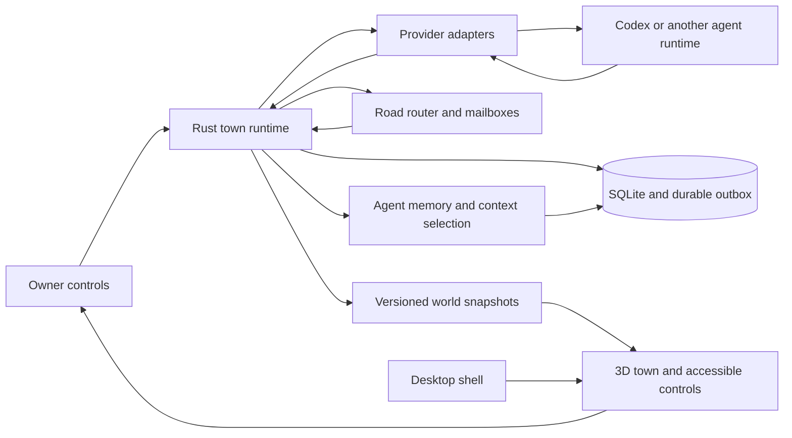

# Agent City implementation specification

Version 2.1. Prepared October 14, 2026. Updated with owner lifecycle clarifications on October 16, 2026. Product name: Agent City. Intended recipient: T3 and its implementation agent.

The October 16 clarification makes mayor-only startup, task-driven staffing and city founding, and non-destructive retirement and mergers required product behavior. The owner subsequently deferred agent-initiated leadership voting to future work. Manual Chief replacement remains in scope. Other staged-delivery wording describes implementation order, not optional requirements. The owner subsequently approved the vision and authorized the full build. See `docs/BUILD-STATUS.md` for implementation and validation status.

Build a local desktop application in which persistent AI agents inhabit a small, attractive town. The owner talks to a mayor, watches specialists collaborate, and intervenes through a single approval queue. Houses represent agent identity and memory. Roads represent permitted message routes. Couriers represent actual exchanges. The town changes as useful work accumulates.

Agent City includes real backend agent deployment and management. The mayor is a real coordinating agent whose authorized decisions create managed residents, assign work, and dispatch provider runs through the backend. The frontend makes that execution understandable through the city rather than requiring the Chief to follow log lines. Its characters, houses, roads, activity labels, and inspectors reflect backend identities, records, messages, and execution states. A visual change alone never deploys an agent or establishes that work ran.

This document is the authoritative implementation handoff. It supersedes the earlier pixel-dashboard prototypes, the earlier build specification, and the earlier System Design document wherever they differ. Those prototypes are rejected as the visual target. Preserve the useful integration and reliability findings, not their composition or art style.

The eight Hamlet screenshots establish the evolving-settlement interaction model and spatial readability. The four newer Solo Leveling screenshots establish the preferred System interface treatment. The owner has clarified that medieval art is optional, while Cyberpunk 2077 and Solo Leveling are the preferred directions. The user's transcription is evidence for the desired interaction model, not proof of Hamlet's underlying implementation. The new application is an original implementation inspired by that model. It does not depend on access to Hamlet's source code, assets, or services.

## Reading guide

Read this document in full before fixing the architecture. Use the following sections during implementation:

- [Problem statement](#1-problem-statement)
- [Product contract and defaults](#2-solution-and-product-contract)
- [User stories](#3-user-stories)
- [Architecture and domain contracts](#4-implementation-decisions)
- [Managed Codex integration](#415-managed-codex-integration)
- [Visual direction](#425-visual-direction-and-composition)
- [Native overlay behavior](#433-overlay-and-macos-lifecycle)
- [Testing and acceptance](#5-testing-decisions-and-acceptance-criteria)
- [Scope boundaries](#6-out-of-scope-and-staged-features)
- [Build sequence and execution instructions](#7-delivery-plan-and-agent-execution-instructions)
- [Reference images and technical sources](#8-further-notes-and-reference-material)

For a new implementation session, also use the companion `T3-START-PROMPT.txt`. The master specification remains authoritative if the short prompt omits detail.

## 1. Problem statement

The owner uses agents across tools and wants to coordinate work without repeatedly copying messages, reconstructing context, and checking disconnected logs. A conventional dashboard can report activity, but it does not provide the sense of place, continuity, and visible collaboration that motivates the owner.

The owner wants the experience of a tactical commander overseeing a developing settlement. They should be able to give a goal to one coordinator, see responsibility distributed among specialists, and understand when their intervention matters. The application must complement actual work. It must not create a second management burden, manufacture busywork, or use significant computation merely to appear alive.

The previous prototypes failed to capture the desired visual quality. They put flat pixel scenery inside a dashboard and left most meaning in panels. The new target is an evolving spatial settlement with deliberate art direction, readable routes, identifiable characters, and an optional day/night cycle. Stylized 3D is welcome if its artistic quality and measured resource use justify it. A carefully drawn 2.5D implementation is also valid. Detailed controls appear when needed.

## 2. Solution and product contract

### 2.1 Confirmed requirements

The following requirements come directly from the conversation:

| ID | Requirement |
| --- | --- |
| C-01 | Target a MacBook Pro with an M2 Max and 96 GB RAM. |
| C-02 | Provide an always-visible desktop overlay that complements other work. |
| C-03 | Support assigning tasks and pausing and resuming managed agents in the first usable release. |
| C-04 | Pause means request interruption and prevent new work. Resume means continue from saved context. Exact execution freezing is not required. |
| C-05 | Keep the application lightweight and portable. Treat resource use as a measured requirement. |
| C-06 | Translate real units of work into understandable character and world behavior. |
| C-07 | Provide an engaging tactical-management experience with persistent progress. |
| C-08 | Preserve the Hamlet reference's evolving settlement, persistent homes, and visible collaboration. Its medieval setting is not required. |
| C-09 | Incorporate the concept of persistent agents, a mayor, houses, stored notes and skills, communication roads, and a shared approval list. |
| C-10 | Preserve the owner's ability to overrule the mayor. |
| C-11 | Support local and hosted providers. Offline execution with already installed local models, including the mayor, is a core release requirement. Codex is the initial hosted-runtime integration candidate. |
| C-12 | Prioritize Cyberpunk 2077 and Solo Leveling versions. Use the newly supplied blue System panels for Solo Leveling interface direction. Medieval fantasy is optional only if artistically compelling. |
| C-13 | Make reasonable implementation decisions without repeatedly interviewing the owner. Record assumptions and adapt when corrected. |
| C-14 | Present necessary binary decisions in a compact themed menu with Accept and Deny. Explain the proposed action and consequence briefly, with details available on expansion. |
| C-15 | Let the Chief ask the mayor about progress and steer an existing task. Support interruption and a revised continuation when live provider steering is unavailable. |
| C-16 | Let the mayor select approved model and resource profiles for each task. The backend validates capabilities, availability, privacy, authority, and resource limits before dispatch. |
| C-17 | Clicking an agent or its house opens a compact current-work menu, with expandable skills, memory, and history. |
| C-18 | Separate project identity from city identity. Several cities and mayors can cooperate on one project's common goal, with task-driven city founding and retained work for later continuation. |
| C-19 | Keep project selection and deliverable access simple. Provide one project Results view rather than requiring navigation through individual agent histories. |
| C-20 | Give mayors coordination skills and relevant domain skills. Mayors assign applicable approved skillsets to provisioned agents and verify that the selected model and tools support the assignment. |
| C-21 | Keep every menu simple and task-focused. Show current state and the relevant primary actions first; reveal history, configuration, and diagnostics on demand. |
| C-22 | Set explicit delegation boundaries across agents and cities. Give each task one accountable owner and prevent duplicate dispatch or overlapping implementation assignments. |
| C-23 | Preserve agent history and actionable checkpoints so interruptions retain completed work, instructions, dependencies, and continuation context. Resume from the last confirmed state rather than restarting the project. |
| C-24 | Automatically provision work against currently available compatible local or hosted resources, with offline fallback, measured resource admission, and preserved task identity. Continue feasible work without requiring manual model switching. |
| C-25 | Discover and assign applicable skills from the owner's already downloaded local skill packages. Keep skill selection and required dependencies usable offline, with versioned content and no implied new tool authority. |

The owner has explicitly confirmed the lifecycle rules in section 2.6. Those requirements take precedence over earlier defaults and optional-feature wording. Detailed thresholds and policies not settled by that clarification remain labeled defaults.

### 2.2 Adopted defaults

These decisions let implementation begin immediately:

| Decision | Default | Reason and change rule |
| --- | --- | --- |
| Initial production art direction | Cyberpunk district and Solo Leveling shadow domain | Build two distinct visual treatments of one evolving settlement. Cyberpunk is the reversible initial launch selection; the owner has not ranked the two. Medieval is no longer the default or a required release. |
| Initial execution integrations | Local-model agent execution plus managed Codex sessions when available | Offline capability cannot depend on a hosted provider. Both adapters must pass capability checks for the operations they expose. |
| Desktop architecture | Rust core and Tauri 2 shell | Keep orchestration local and separate from rendering. |
| First rendering candidate | Stylized 3D through Three.js with an elevated orthographic camera | Compare a representative scene with a polished 2.5D treatment. Use measured native resource cost and visual quality to decide. Dimensionality is not a binding requirement. |
| Ordinary controls | TypeScript, HTML DOM, and CSS | Keep the existing compact controls without requiring an additional UI framework. Use native form semantics and accessible text outside the 3D canvas. |
| Local data | SQLite plus inspectable agent-home exports | Transactional state and portable, human-readable memory. Ownership rules appear below. |
| Normal concurrency | Two active provider turns across the town | Protect capacity and simplify initial scheduling. User-configurable within provider limits. |
| Starter population | Mayor only, with the Chief in the separate sanctuary | Specialists and their homes appear when the mayor assigns useful work. |
| Available specialist templates | Scout, reader, analyst, writer, editor, critic, and task-specific roles | Templates do not create residents at startup. The mayor chooses roles for the task. |
| Initial town count | One | The mayor generates additional cities when tasks require them, within the Chief's authorized scope and budget. |
| Ambient overlay | Approximately 420 by 280 logical pixels | Resizable and repositionable. Show a meaningful crop, not the entire command center shrunk to illegibility. |
| Expanded window | Approximately 1280 by 800 logical pixels | Adapt to the display's available area. |
| Initial provider authorization | User-selected workspace and provider's normal approval policy | Never silently replace that policy with unrestricted access. |
| Task acceptance | Explicit owner acceptance for the top-level result | Specialist completion is separate from acceptance of the final outcome. |
| Idle behavior | No model calls without work or an explicit request | Ambient animation is optional and independently throttled. |
| Local models | Required in the first usable release, initially through the existing native Ollama hosting setup or another verified compatible endpoint | Reuse installed weights. Supply a real bounded agent/tool loop, not text-only inference. No model download is required for ordinary offline operation. |

T3 is the tool receiving this specification. Do not infer that the finished application must depend on T3, use the T3 web stack, or run inside a hosted T3 environment. If that environment cannot run native macOS checks, build the portable modules and simulation there, then provide a precise local validation path. Native overlay behavior cannot be declared complete from browser tests.

### 2.3 Product principles

1. Every important visual state has a real, inspectable meaning.
2. The owner can understand the next needed action without reading a full transcript.
3. Persistent identity survives provider sessions, process restarts, and model changes.
4. Agents act within explicit permissions, budgets, and communication routes.
5. The runtime, not a model's assertion, decides whether a command is authorized or complete.
6. A graceful idle state is a successful state. The app does not invent tasks to keep residents moving.
7. The owner retains control over goals, permissions, spending, topology, and leadership.
8. Cosmetic progression follows useful outcomes and does not grant real execution privileges.
9. The application remains useful with motion, audio, and decorative effects disabled.
10. Portability includes data and behavior, not just compiling the same source on another platform.

### 2.4 First end-to-end experience

The owner opens a cyberpunk district or shadow domain with only the mayor as an agent. The Chief has a separate sanctuary and remains visible. There are no pre-created specialists or specialist homes. The view labels the state as Demo until a real provider connects.

Selecting the mayor opens a small, theme-specific menu with a task entry. The owner submits: "Compare three approaches for our project's agent event transport. Give me a recommendation with sources and an implementation checklist." They choose a permitted project and a bounded task budget. Scope and budget can use existing defaults, with details available on expansion.

The mayor creates a short plan, chooses the roles that add value, and creates or recalls the needed residents. Each new resident receives a house with its own skills, notes, and history, and an initial road to the mayor. For a large research task, a scout may gather material, a reader extract evidence, an analyst compare options, a writer draft, an editor improve clarity, and a critic check claims. This is an example, not a required sequence. Roles may be combined or skipped.

A courier carries a visible message along the scout's road to the mayor, then toward the reader. Delivery happens in the runtime independently of walking animation. Clicking the courier reveals sender, recipient, purpose, status, and an appropriately redacted summary.

If an agent needs access outside its existing permission, a single request enters the approval queue. The relevant house gains an attention marker. Other independent work can continue. The window does not steal focus.

The owner can pause one resident or the town. The app shows pending interruption until the provider confirms it. Resume creates a continuation turn from retained context. The town preserves notes and message history.

The mayor presents the final result with sources, review findings, and outstanding limitations. The owner accepts it. The acceptance ledger records one completed outcome, and the town receives a small cosmetic improvement. Closing and reopening the app preserves the town, its residents, their knowledge, and its accepted work.

### 2.5 Release boundaries

The first usable release must contain a real managed-agent workflow, an artistically coherent evolving settlement, persistent homes, enforced application-mediated message routes, visible message delivery, a working approval queue, pause/continue controls, and durable recovery. A static mockup or an observation-only dashboard does not satisfy this release.

### 2.6 Owner-confirmed city lifecycle

The owner confirmed these rules on October 16, 2026:

- Start with only the mayor as an agent. In Solo Leveling, the initial mayor is Igris. The Chief is the human owner and does not count as a worker.
- Selecting the mayor opens a compact task menu. Agent house menus lead with current work and expose skills, notes, and history on demand. Every menu follows the selected theme.
- The same mayor menu accepts progress questions and direction changes for an existing goal. Necessary binary decisions use Accept and Deny, with a short explanation and optional expanded details. Routine delegation within existing authority continues without a Chief decision.
- The mayor chooses, assigns, creates, recalls, retires, or merges residents as task needs change. Do not require the Chief to configure every specialist or route each handoff manually. Apply existing authority and budget limits without asking for repeated approval of already authorized decisions.
- Deployment and management are real backend operations. Assigned agents receive their own role, selected context, permitted tools, persistent records, and provider execution binding. The backend dispatches their work when dependencies, authorization, and capacity permit. Show queued, starting, running, blocked, failed, and completed states from observed backend events, rather than inferring them from animation or mayor prose. Preserve the work and its records when the city view is hidden or closed while the backend remains running. Idle residents retain identity without continuous inference or a dedicated model process.
- Every resident has a house containing its skills, notes, and history. Retirement removes a resident from the active workforce without deleting that identity or its records. Mergers preserve the source identities, knowledge, histories, and successor links.
- Inactivity consumes no inference tokens and causes no penalty, decay, or automatic retirement. Review staffing when relevant work or a bounded review requires a decision, rather than through continuous mayor polling. Day and night alone do not trigger inference.
- Agents communicate along roads. A new resident starts connected to the mayor, and messages default to that relay until a permitted direct road exists. The mayor can establish direct roads within authorized policy. Relay transport alone does not require mayor inference.
- More genuine messages develop a road visually, eventually into a railroad or its theme equivalent. The exact counting rule in section 4.11 remains a tunable default. Retries, duplicate deliveries, and invented chatter must not manufacture progression.
- Agent-initiated leadership voting is future work, outside the current build scope. Retain the proposed two-thirds vote and the former mayor remaining an ordinary resident as the future design. The Chief can replace the mayor directly without an election.
- When tasks require a separate city, the mayor generates one and delegates work there within the Chief's authorized limits. Each new city starts with its own mayor, then staffs for its work. Connect cities through permitted roads and retain separate project context and budgets.
- A project can contain several cooperating cities. The original mayor remains the lead contact for the shared goal while additional mayors coordinate scoped work such as development or marketing. Project files, accepted facts, results, and spending limits remain associated with the project rather than being fragmented into unrelated city records.

Population, cities, and routes can grow or consolidate as work requires. Preserving idle residents is valid. Cosmetic evolution does not grant permissions or prove task success.

Mergers, agent-initiated leadership votes, inter-town roads, and additional providers belong to later milestones. Cyberpunk and Solo Leveling visual treatments belong to the first-preview scope, using one compact asset kit per treatment and the same runtime. Additional neighborhoods and optional medieval art can follow later. Deferred governance and multi-town records must not require replacing agent identity, message storage, or the command contract. Build the shared work lifecycle before expanding governance interfaces.

## 3. User stories

### 3.1 Everyday use

1. As the owner, I want to give the mayor an outcome, so that I do not manually coordinate every specialist.
2. As the owner, I want to see who is working and on what, so that I can understand the town at a glance.
3. As the owner, I want idle agents to stay home without inference calls, so that the town does not create unnecessary cost.
4. As the owner, I want to inspect a house, so that I can understand its resident's role and current work.
5. As the owner, I want to assign work directly to a specialist, so that the mayor does not become a mandatory interaction bottleneck.
6. As the owner, I want a brief plan with identifiable deliverables, so that delegated work remains connected to my goal.
7. As the owner, I want to see dependencies between tasks, so that waiting is distinguishable from failure.
8. As the owner, I want a clear final result and acceptance action, so that completion has a useful meaning.
9. As the owner, I want to request revisions, so that an unsatisfactory result does not count as success.
10. As the owner, I want to browse accepted outcomes, so that the town reflects what I actually accomplished.

### 3.2 Persistent residents and memory

11. As the owner, I want agent identities to survive sessions, so that a familiar resident remains the same worker over time.
12. As the owner, I want each home to expose notes, skills, and history, so that its continuity is inspectable.
13. As the owner, I want important knowledge to load on the next relevant task, so that saving a note has practical value.
14. As the owner, I want notes to cite their origin, so that I can judge whether they are reliable.
15. As the owner, I want to correct or retire a stale note, so that the agent does not keep repeating an obsolete assumption.
16. As the owner, I want to pin instructions, so that a model-generated summary cannot silently overwrite my preferences.
17. As the owner, I want to change a resident's provider or model, so that identity is independent of inference infrastructure.
18. As the owner, I want to export an agent's portable memory, so that I can move or back up my working environment.
19. As the owner, I want agent merges to preserve lineage, so that consolidation does not erase where knowledge came from.
20. As the owner, I want an explicit deletion option, so that archival does not become a promise to retain unwanted information forever.

### 3.3 Communication and governance

21. As the owner, I want roads to correspond to permitted message paths, so that the map explains collaboration.
22. As the owner, I want new residents to connect to the mayor, so that the initial topology is simple and legible.
23. As the owner, I want messages without a direct road to relay through the mayor's junction, so that delivery does not require manual copying.
24. As the owner, I want to see why a new direct road is proposed, so that topology changes have a purpose.
25. As the owner, I want to inspect exchanges on a road, so that I can diagnose repeated or unproductive communication.
26. As the owner, I want established collaborations to become railroads, so that useful patterns become visible over time.
27. As the owner, I want loop limits, so that agents cannot keep waking each other indefinitely.
28. As the owner, I want to override a mayor's plan or assignment, so that orchestration remains accountable to me.
29. As the owner, I want to replace the mayor, so that leadership is a configurable role rather than an irreplaceable agent.
30. As the owner, I want later agent leadership proposals to include reasons and evidence, so that voting is inspectable.
31. As the owner, I want the former mayor to remain as a resident after replacement, so that leadership changes preserve useful knowledge.
32. As the owner, I want the mayor to found additional cities when tasks require them, so that separate projects and budgets remain distinct while sharing selected results.

### 3.4 Control and permissions

33. As the owner, I want one approval list, so that I do not search across sessions for blocked work.
34. As the owner, I want each approval to show the exact action and scope, so that Allow has a concrete meaning.
35. As the owner, I want Deny to produce a clear result for the requesting agent, so that it can adapt rather than repeat the request.
36. As the owner, I want to pause a managed resident, so that I can interrupt its turn and hold its queue.
37. As the owner, I want to see Pausing until acknowledgement, so that a request is not mistaken for a completed stop.
38. As the owner, I want to resume from saved context, so that I do not have to reconstruct the task.
39. As the owner, I want to pause the whole town, so that new work stops across its managed residents.
40. As the owner, I want child and background work to remain visible, so that pausing a parent does not hide continuing activity.
41. As the owner, I want unavailable controls to explain their limitations, so that observed agents are not presented as fully managed residents.
42. As the owner, I want a configurable concurrency and call budget, so that the app respects my machine and provider resources.
43. As the owner, I want unknown costs to be labeled unknown, so that missing billing data is not represented as zero.
44. As the owner, I want provider permissions to remain effective, so that the town does not weaken existing safeguards.

### 3.5 Desktop and visual experience

45. As the owner, I want a small click-through overlay, so that the world can remain visible while I work elsewhere.
46. As the owner, I want a shortcut and menu-bar action to enter Command mode, so that I can regain interaction reliably.
47. As the owner, I want the overlay to preserve typing focus, so that incoming events do not interrupt my work.
48. As the owner, I want an expanded town view, so that I can inspect communication and manage several residents.
49. As the owner, I want a day/night cycle and warm lighting, so that the world has atmosphere without requiring interaction.
50. As the owner, I want meaningful activity animations, so that reading, writing, waiting, and reviewing look different.
51. As the owner, I want camera and label controls that remain readable at small size, so that the overlay is useful rather than decorative noise.
52. As the owner, I want quiet and reduced-motion modes, so that the world can adapt to concentrated work.
53. As the owner, I want keyboard and screen-reader access to the same state, so that the canvas is not the only way to operate the app.
54. As the owner, I want different visual themes to share one work model, so that theme changes preserve all real progress.

### 3.6 Reliability and portability

55. As the owner, I want recovery after an app crash, so that a lost acknowledgement does not launch duplicate work.
56. As the owner, I want disconnected and uncertain states to be explicit, so that the app does not invent success.
57. As the owner, I want my town to survive sleep and display changes, so that it remains usable all day.
58. As the owner, I want bounded resource use and storage growth, so that the town leaves room for my actual agents.
59. As the owner, I want export and restore without credentials, so that moving the town is practical and safe.
60. As the owner, I want a repeatable demo mode, so that I can inspect the experience without paying for inference or connecting an account.

## 4. Implementation decisions

### 4.1 Architecture and module ownership

Use a Rust domain core inside a Tauri desktop application. Keep a separate provider process when a provider requires it. Use one webview for the town and its normal controls initially. Do not run a permanent local HTTP application server merely to connect the view to the core.

The core is the only writer of authoritative work state. The frontend submits typed commands and receives versioned snapshots or patches. The frontend can own temporary camera position, hovered objects, open panels, and animation playback. It cannot declare a provider turn complete, award progression, approve a permission request, or change a road directly.

Use these logical modules. Actual source layout can follow the chosen project's conventions.

| Module | Owns | Interface used by callers |
| --- | --- | --- |
| Town runtime | Residents, tasks, command validation, scheduling, policy, and world snapshots | Submit command, ingest provider event, read snapshot, subscribe to revisions |
| Provider adapters | Provider connection, capabilities, transport, schema translation, and reconciliation | Start or continue run, interrupt, resolve supported approval, inspect state, receive events |
| Message router | Road authorization, durable mailbox delivery, ordering, and loop bounds | Send, claim, acknowledge, inspect exchange |
| Agent memory | Memory revisions, context selection, skill manifests, session summaries, and home projections | Read home, propose revision, accept revision, prepare run context |
| Local store | Transactions, indexes, outbox, migrations, archive, and export | Commit domain changes, read records, replay projections, make backup |
| World renderer | Buildings, terrain, couriers, selection, animation, lighting, and level of detail | Render a world snapshot and emit selection intent |
| Desktop shell | Window modes, menu bar, shortcut, focus, display placement, and app lifecycle | Enter mode, hide or restore, persist placement, handle lifecycle events |

The main test seam is the Town runtime command-to-snapshot interface, using an in-memory fake provider and controllable clock. This extends the lifecycle seam already accepted by the owner. Provider contract checks and native window checks exercise behaviors that cannot be established at that seam.

Keep a single instance per data directory. A second launch focuses the existing instance or reports the lock holder. The data-directory lock and database transactions jointly prevent two schedulers from dispatching the same task. Renderer restart does not restart the provider automatically.

Start without a persistent background daemon. Hiding the overlay leaves the application running. Quitting with managed work active shows that work and offers to interrupt and quit, or keep running hidden. If a later daemon is introduced, it must reuse the same command and data contracts rather than becoming a second scheduler.

### 4.2 Dependency and compatibility policy

Pin tested Rust, Tauri, frontend, renderer, and provider versions in the implementation's lockfiles and compatibility record. Use current official documentation for the installed version. This document specifies behavior, not a claim that every release has identical APIs.

Use Three.js directly before adding a second scene abstraction. Use TypeScript DOM controls and CSS for menus, with no required React dependency. An animation frame must not rebuild application panels. Keep the renderer behind a small interface so a pre-rendered isometric implementation or a native renderer can replace it without changing task semantics.

The first rendering spike compares a representative stylized 3D scene with a polished 2.5D scene against the target resource budgets inside WKWebView. If it fails, measure the cause. Reduce unnecessary effects and scene complexity before changing engines. Do not claim that Rust makes frontend rendering free. Do not switch to Bevy, Electron, or a native renderer solely because of a benchmark taken from a different workload.

Minimum macOS support is an installation-time engineering decision. Target the owner's installed version first and record it. Do not guess the installed version from the chip. Cross-platform data portability is required now. Native Windows and Linux overlay releases are later work.

### 4.3 Domain entities and invariants

| Entity | Meaning | Required invariant |
| --- | --- | --- |
| World | Owner's collection of towns and global preferences | Has one owner-controlled policy root. |
| Project | Persistent purpose, goals, workspace references, accepted knowledge, and deliverables | Has a stable identity independent of its cities; defines shared scope and spending limits. |
| Town | A city team of residents, roads, tasks, and an allocated budget within a project | Has one project and exactly one current mayor assignment when operational. A project can have several towns. |
| Lead mayor assignment | Existing city mayor coordinating a project's shared goal | Has one current responsible mayor per top-level goal without requiring another management agent. |
| Resident | Persistent agent identity | Has a stable ID independent of provider, model, name, and session. |
| Mayor assignment | Current coordinator role for a town | References a resident plus a monotonically increasing leadership epoch. |
| House | Resident's visual anchor and inspectable home | References exactly one resident; moving it does not move authority or change identity. |
| Provider binding | A resident's execution configuration | Declares actual capabilities and permission profile. |
| Session | Provider-specific context associated with a resident | Keeps provider IDs opaque and records continuity quality. |
| Goal | Outcome requested by the owner | Belongs to one project and has an acceptance definition, responsible lead mayor, and budget. Cities can contribute to the same goal. |
| Task | A bounded piece of work within a goal | Has a stable ID, owning project, assigned city and resident, dependencies, and a result contract. |
| Run | One attempt or continuation of a task | Has a unique ID and provider-turn correlation. |
| Activity | One observed operation within a run | May overlap other activities; does not independently determine task success. |
| Road | A permitted application-mediated communication relation | Connects distinct residents or later town gateways; permissions are explicit. |
| Message | A durable communication envelope | Has a stable ID, sender, recipient, lineage, route, and delivery status. |
| Approval | A specific pending owner decision | Is bound to an exact action, authority revision, and expiry. |
| Memory revision | A version of inspectable agent knowledge | Records provenance, author type, and the prior revision. |
| Deliverable | A promised reviewable output of a goal or task | Belongs to a project and references produced artifact versions, review evidence, and acceptance status. |
| Artifact | An output produced or referenced by work | Has an identifier, project, source task and run, version, location, type, and integrity information when available. |
| Acceptance | Authorized review decision about a task or goal result | Records reviewer and evidence. Only the owner accepts a top-level goal; a delegated reviewer may accept an internal task. |
| Reward | Cosmetic progress earned from acceptance | Is unique for its acceptance identity and rule version. |
| Election | Later proposal to replace the mayor | Freezes its electorate, candidate, threshold, and leadership epoch. |
| Merge | Later consolidation into a successor resident | Preserves source identities and knowledge provenance. |

Use globally unique opaque IDs generated by the application. Names are editable labels. A task cannot depend on itself or create a dependency cycle. A road cannot connect a resident to itself. An archived resident cannot receive new executable work. A task can have only one active run unless it explicitly contains parallel child tasks. A town can have many queued tasks but only its configured number of active provider turns.

Retiring a resident removes its active execution eligibility, not its historical identity. Deleting data is a separate owner action with an explicit scope and resulting broken-reference markers where necessary.

### 4.4 Agent identity and provider capabilities

Each resident stores a name, role template, role instructions, town membership, house association, lifecycle state, provider binding, memory revision, and created/updated timestamps. Optional cosmetic appearance is data, not executable behavior.

Each binding reports these capabilities separately: observe lifecycle, start a task, continue context, interrupt a turn, inspect active work, resolve provider approval, enumerate children, inspect background work, supply tool-level events, report usage, and open the source session. Unsupported capabilities remain false until tested.

Show a resident as Managed only when the runtime owns or has a verified control channel for its execution. Show an externally observed agent as Observed, with last contact and available actions. An adapter may expose more control later, but the UI must not imply that all residents are equivalent.

The appearance of a process does not establish task progress. Parsing an undocumented transcript is an optional, version-specific observation fallback. Such events are marked inferred. An adapter failure changes observation quality; it does not erase the resident or complete its tasks.

Changing a provider creates a new binding revision. Existing active runs retain their original binding until finished or explicitly interrupted. The new provider can receive selected persistent memory and task context, but the app must not promise lossless transfer of opaque provider state.

The mayor selects from a catalog of approved execution profiles. Each profile identifies its provider and model, supported capabilities, permitted data destinations and tools, context and output limits, and concurrency constraints. Selection considers task difficulty, evidence requirements, privacy, deadline, current availability, and observed quality and resource measurements. Do not assume that the smallest model can perform a required tool workflow or that the largest available model is always necessary.

The backend admits or queues the selected configuration using actual provider readiness, model-host capacity, system resource observations where available, and global limits across all cities. Mayor estimates cannot override those checks. New model downloads, providers, data destinations, or spending outside existing authorization require a scoped Chief decision. Several residents may share one loaded model service. Do not imply a fixed physical RAM partition per resident or promise that a token limit is an enforceable monetary cap. Record configuration changes and the reason for escalation, including any failed verification that led to a stronger profile.

Automatic provisioning chooses the best known feasible configuration under the Chief's quality, privacy, cost, latency, and resource constraints. Maintain a bounded inventory of configured local hosts, installed models, actual capabilities, loaded models, host capacity, provider readiness, and supported local tools. Distinguish an installed local model from a cloud-backed model exposed by a local endpoint. Use cached measurements and bounded capability checks instead of launching inference merely to poll availability. Prefer an already loaded suitable model when that avoids needless loading, and adjust concurrency or context allowance only while preserving required instructions and task capability. Queue work rather than overcommit the machine. Respect other applications using the shared model host and never unload their work without authority. This is measured adaptive selection, not a claim of mathematically optimal allocation.

### 4.5 Independent state dimensions

Do not implement one giant status field for everything. Keep the following state dimensions separate:

| Dimension | States |
| --- | --- |
| Resident lifecycle | Active, retired, archived |
| Scheduling | Available, queue held, budget held, disabled |
| Provider connection | Connected, reconnecting, disconnected, incompatible, unavailable |
| Task | Draft, queued, running, waiting for input, pausing, paused, review, accepted, failed, cancelled, unknown |
| Run | Preparing, submitted, active, interrupt requested, interrupted, completed, failed, outcome unknown |
| Activity | Reading, researching, writing, editing, analyzing, testing, communicating, waiting, unknown working |
| Visual behavior | At home, walking, working, delivering, requesting attention, celebrating, disconnected marker |

The UI computes a concise status from these dimensions and can reveal the details. For example, a house can contain an active resident whose queue is held, whose last task is paused, and whose provider is disconnected. It must not collapse that into a misleading Idle label.

Core task transitions are defined below. Any transition not justified by a command or authoritative event is rejected or recorded as an adapter anomaly.

| Current task state | Trigger | Result |
| --- | --- | --- |
| Draft | Validated assignment | Queued |
| Queued | Provider confirms start | Running |
| Queued | Owner cancels before dispatch | Cancelled |
| Running | Specific input or approval required | Waiting for input |
| Running or waiting for input | Owner pause request | Pausing; hold further dispatch |
| Pausing | Provider confirms interruption | Paused |
| Pausing | Provider finishes first | Review or failed; queue stays held |
| Pausing | Acknowledgement becomes uncertain | Unknown; queue stays held |
| Paused | Owner resumes and provider confirms continuation | Running with a new run/turn correlation |
| Waiting for input | Required input resolves | Running only when provider continuation is confirmed |
| Running | Result arrives with no unresolved execution | Review |
| Running | Confirmed terminal failure | Failed |
| Review | Authorized reviewer accepts the result | Accepted; top-level goal acceptance requires the owner |
| Review | Owner requests revision | Queued revision attempt under the same task |
| Failed | Owner retries after inspecting prior effects | Queued new attempt |
| Any executing state | Transport loss with unresolved execution | Unknown observation until reconciliation |
| Accepted | Owner reopens | Draft or queued revision; reverse acceptance reward as defined later |

Never treat a completed tool call as task completion. Never treat a lack of recent events as proof that a provider stopped. Use a current provider state query where available and retain uncertainty where it is not.

Internal task review does not require an owner click for every specialist. Each plan names a reviewer, normally the mayor or a designated reviewer resident, and states the required evidence. The Rust core verifies that the reviewer has authority for that task. A specialist cannot self-accept unless the owner explicitly chose a deterministic acceptance rule that the core can evaluate. Internal acceptance creates no top-level goal reward. The owner's final acceptance remains separate.

A dependency normally becomes ready when its predecessor's deliverable has passed its declared internal review. If a plan explicitly permits a provisional draft, record that exception and label the input provisional. Failed, cancelled, or unknown predecessors do not silently satisfy dependencies. When a predecessor is revised, dependent outputs retain the input revision they used and become visibly stale until reviewed or rerun. The owner must not manually relay ordinary outputs between stages.

### 4.6 Scheduler and execution budgets

The scheduler is deterministic application code. It selects runnable work using town priority, task priority, dependency readiness, owner pause state, and FIFO creation order within equal priority. It does not require an LLM call to select the next item from an already approved plan.

Reserve a concurrency slot before provider dispatch and release it on confirmed terminal state or reconciled non-execution. A lost connection does not automatically free the slot and launch replacement work. Distinguish an active slot from a sleeping resident.

Default limits are two simultaneous provider turns per world, one active turn per resident, twelve planned tasks per goal, thirty application-level messages per goal, two critic/revision rounds, and twenty provider turn starts per goal. These are proposed starter limits. Expose them in an advanced goal policy and record the policy snapshot used for each run.

Provider turn limits do not imply a bound on every internal model call or tool invocation. Where a provider reports tokens or cost, track them. Where it supports enforceable usage limits, apply them. Otherwise label the corresponding estimate and limit as advisory. Never promise a hard monetary cap that the provider cannot enforce.

When a deterministic count limit is reached, hold new dispatch and present a concise continuation request. Include work completed, work remaining, the exhausted limit, and the requested extension. The mayor cannot increase its own limit. Internal relays and visual couriers do not consume model-call budget unless a resident actually reasons about a message.

A runnable task must have a permitted workspace, a compatible provider, enough scheduling capacity, all required dependencies satisfied, and no unresolved approval for its next operation. Unrelated tasks can continue while one waits for the owner.

No idle deliberation loop is allowed. Residents wake because a task becomes runnable, a relevant message is delivered, a requested human response arrives, or the owner explicitly asks them to reason. A day/night change, decorative event, or appearance upgrade never wakes a model.

The mayor ends its planning turn after delegation and waits for a relevant result as durable queued work. Do not keep a coordinator turn occupied polling for its workers. A resident's dependency wait also does not reserve a provider slot unless execution is still genuinely active or uncertain. Multiple messages for the same waiting resident can form one bounded next-turn context, with every included message ID recorded.

Protect shared project files from concurrent writers. The first release uses a workspace write lease that serializes managed mutating runs in the same checkout. Read-only runs may proceed concurrently only when their tools enforce that limitation. Parallel coding work can later use separate Git worktrees with explicit merge and conflict handling. Never assume that two separate residents imply two separate filesystems. A lost or uncertain writer retains its lease until reconciliation; do not clear the lease solely because a timer expired. Unmanaged external editors remain outside this guarantee and require change detection before applying a stale patch.

### 4.7 Mayor behavior and role templates

The mayor is a resident with coordinator privileges granted by policy. Those privileges are narrower than the owner's. The mayor can propose plans, delegate tasks, request residents, propose roads, summarize outcomes, and request decisions. The core validates every proposed action.

The mayor's operating instructions must establish these behaviors:

- Convert the owner's goal into concrete deliverables and acceptance criteria.
- Reuse suitable residents before creating new ones.
- Delegate only when the expected value exceeds coordination overhead.
- Prefer a short plan. Do not force every goal through all six specialist roles.
- Identify missing evidence, conflicting results, and blocked dependencies explicitly.
- Preserve source attribution when forwarding findings.
- Ask the owner only for a decision that existing authority, context, and defaults cannot resolve.
- Stop or request more budget when a limit is reached.
- Present a final result with review status and remaining uncertainty.
- Never claim that a command succeeded solely because the mayor requested it.

Every delegated task records one accountable resident, its assigned city, goal and plan revision, bounded scope, explicit exclusions where overlap is possible, input and source versions, expected deliverable, completion criteria, and dependencies. Before creating work, the mayor checks existing assignments and reusable results across the project. Peer mayors use that same project task record rather than independently launching the same assignment. A review or deliberately independent investigation has its own stated purpose and result, so it is distinguishable from redundant execution.

The backend enforces unique dispatch identity and one active owner/attempt for ordinary tasks. Reassignment or a steering change does not authorize a replacement run while the prior execution remains uncertain; reconcile or confirm interruption first. Parallel child tasks have distinct scopes and output ownership. The shared-workspace write controls still apply across cities. Boundary conflicts return to the responsible mayor for resolution without asking the Chief to manually coordinate routine handoffs.

The starter specialists have these responsibilities and bounded outputs:

| Role | Responsibility | Expected result |
| --- | --- | --- |
| Scout | Find relevant resources within allowed tools and sources | Candidate resources with source location and relevance |
| Reader | Extract evidence from supplied resources | Findings with citations, caveats, and unanswered questions |
| Analyst | Compare evidence against the goal's criteria | Recommendation, alternatives, tradeoffs, and confidence reasons |
| Writer | Produce the requested deliverable | Draft artifact with traceable sources where applicable |
| Editor | Improve clarity, organization, and consistency | Revised draft and a short change summary |
| Critic | Test claims against evidence and acceptance criteria | Specific issues, severity, evidence, and proposed corrections |

Coding tasks may use builder, reviewer, and tester templates instead. A tester must report the command and observed result, not invent test success. A critic's objection is evidence for review, not automatic authority to block forever. The mayor can resolve a documented disagreement within the goal's policy or escalate it after the configured review rounds.

Resident creation starts as a proposal. The owner may authorize the mayor in advance to create residents within an allowed role list and population cap. Default initial cap is twelve active residents per town. Creation registers a real managed backend identity, home, default mayor road, provider binding, and explicit permissions inherited from the approved town policy without expansion. A runnable assignment dispatches actual provider work when a slot is available. Creating a resident without runnable work does not start inference. Separate identities do not require separate model weights or permanently running processes. The frontend renders the backend receipt and subsequent execution events; it cannot substitute a new character for deployment.

The owner can modify or reject a plan, redirect an assignment, hold a queue, retire a resident, change a binding, and replace leadership. Each action creates a new revision. A stale mayor decision that refers to an earlier plan or leadership epoch must not overwrite the owner's change.

### 4.8 Roads and routing semantics

Roads are logical communication permissions with visual paths. A road has endpoints, allowed directions, message-purpose permissions, status, creation provenance, and topology revision. For the first release, new resident roads to the mayor allow messages in both directions. The data model still stores direction explicitly.

The initial town is a star centered on the mayor. For same-town communication, the router follows this deterministic policy:

1. Deliver along an enabled direct road if its direction and purpose permit the message.
2. Otherwise, use the sender-to-mayor and mayor-to-recipient roads if both are enabled and permit relay.
3. Otherwise, leave the message blocked and expose the missing authorization. Do not invent a road or bypass the policy.

Relaying through the mayor's junction is a routing action, not automatically a mayor reasoning turn. The envelope retains the original sender and recipient, plus the relay route. The mayor can inspect routing records. If the content requests a mayor decision, it creates explicit mayor work rather than an invisible routing side effect.

The first release does not search arbitrary chains through other residents. A three-resident relay chain would add interpretation and permission questions without improving the initial product. Later routing can extend the policy only through a versioned change with loop and provenance tests.

Creating a direct road is a core command with the endpoints, directions, permitted purpose, reason, and expected topology revision. The default policy requires owner confirmation unless the owner has authorized automatic same-town roads within a stated scope. The mayor cannot use a message to grant itself road-creation authority.

Removing or disabling a road prevents new claims using that road. Queued messages are revalidated before delivery and may use the valid mayor route instead. Already delivered content cannot be recalled by deleting a road. Preserve its historical route and delivery record.

Road enforcement applies to application-mediated messages. If an agent has unrestricted shell, filesystem, or network access, it may communicate outside this channel. The application must disclose that limitation. Strong isolation requires provider sandbox support and restricted access to other homes, sockets, and external channels. A drawn road is not a complete security boundary.

Keep the message tool narrow. The runtime supplies authenticated sender identity and ignores a model-supplied attempt to impersonate another resident. The tool accepts a recipient, purpose, task correlation, body or artifact reference, and optional reply relationship. It does not accept arbitrary authority, provider credentials, or a fabricated owner approval.

### 4.9 Durable message delivery

Persist a message before exposing it to the recipient. Every message has a stable identifier, town, authenticated sender, intended recipient, goal and task correlation, purpose, body reference, content digest, causation ID, conversation ID, created time, expiry, and delivery state. The applied route and topology revision are recorded on each attempt.

Use these states: queued, blocked, claimed, delivered, acknowledged, failed, expired, and cancelled. Claimed means a receiver has a time-limited processing lease. Delivered means the recipient's inbox or run input durably contains the message. Acknowledged means the receiving work has recorded processing or an explicit response. Courier arrival is not a delivery acknowledgement.

Guarantee idempotent inbox insertion by message ID. Do not claim exactly-once model execution. A crash after provider submission but before acknowledgement can leave processing uncertain. Reconcile the correlated run; do not automatically replay its input into a new provider turn merely because a lease expired.

Preserve FIFO delivery within one sender-recipient conversation when messages have causal dependencies. Independent conversations need no global ordering. A task's prerequisites determine execution readiness, not the decorative order in which couriers arrive.

Default payload limits are 16 KB for an inline message and 1 MB for an individual normalized provider event. Larger results use artifact references with size and type metadata. The router rejects malformed or oversized input before allocating expensive processing. Text displayed in the UI is escaped; artifact content is never executed just because it arrived as a message.

Start with a mailbox capacity of 100 pending messages per resident and 1,000 pending messages per town. Exceeding a limit reports backpressure to the sender and creates a visible diagnostic. It does not silently drop the message or wake a model to explain a condition that code can explain.

Default delivery expiry is 24 hours for an ordinary task message, excluding owner-held pauses from any task deadline only when that policy is explicitly chosen. Expiry prevents a stale message from unexpectedly waking a resident next week. The record remains visible until retention removes it. The owner can resend as a new message after reviewing its relevance.

Track causal depth and per-goal message count. Default causal depth is twelve processing exchanges. Repeated acknowledgement-only messages do not wake the recipient. Exact duplicate content under the same task and causation ID is coalesced or rejected. Distinct reasoning messages remain distinguishable even when their text is similar.

### 4.10 Couriers and traffic representation

A courier represents one message or a clearly labeled group of messages. Its route comes from the router's accepted path. Its visual timing is independent of the delivery mechanism. If processing completes before the animation, show that the courier is a visualization of the exchange rather than forcing work to wait.

Use a short walk or cart journey of approximately one to four seconds in the expanded scene. Long physical paths may compress travel time. Selecting the courier shows delivery timestamps and status, so visual time cannot be mistaken for network latency.

Cap visible couriers at twenty-four in the expanded scene and eight in the overlay. Group additional messages by route and direction with a count. A burst does not create hundreds of characters, speech bubbles, or sound effects. Reduced-motion mode shows a route pulse and a text event instead.

Hover or selection can reveal a brief message purpose. Never display private raw content as unsolicited speech above a character. In ambient overlay mode, default to role and status labels rather than task titles that could appear in a screen share.

### 4.11 Railroads and useful collaboration

A railroad is initially a cosmetic and informational maturity state for a road. It does not change permissions, model quality, execution speed, or message priority. Its visual meaning is that the relationship has supported repeated useful work.

Proposed promotion rule: an enabled road qualifies after twelve distinct acknowledged task-result exchanges spanning at least six distinct tasks. Count at most one qualifying exchange per task and direction. Exclude transport retries, duplicate delivery, empty acknowledgements, and explicitly rejected outputs. This is a tunable default inspired by the reference, not a measured productivity law.

Display the qualification rule and counted contributions in the road inspector. The owner can pin the visual road style or disable progression. Changing the rule version recomputes eligibility deterministically and records the rule version. Do not retroactively fabricate events.

Railroads use a visually distinct track, modest station detail, and optionally a small delivery cart. At small scale, use a single readable line treatment. A theme can reinterpret the railroad as a neon transit link or a shadow gate connection while preserving its meaning.

### 4.12 Persistent homes and memory ownership

Every resident has an inspectable home containing `NOTES.md`, `skills/`, and `sessions/` in its portable representation. These names come from the requested product model. They do not dictate the implementation repository's source layout.

`NOTES.md` is a concise view of durable knowledge, preferences, current commitments, and known limitations. `skills/` contains versioned manifests and permitted supporting resources. `sessions/` contains session summaries, references, and the retained execution history allowed by the user's storage policy.

SQLite is authoritative for resident metadata, task state, messages, approvals, and memory revision metadata. Store each accepted memory revision's content or content-addressed reference transactionally. The human-readable home is a projection with a recorded revision. Do not allow the database and files to become independently authoritative copies.

A committed memory update creates a durable projection job in the same transaction. A worker writes the projection to a temporary file and atomically replaces the previous file. A crash between commit and replacement leaves a recoverable projection job. On startup, repair projections whose revision differs from the committed revision.

An external edit to a home file becomes an import proposal. Compare its base revision with the current revision. If they match, validate and commit it as an owner-authored revision. If they differ, show a conflict and preserve both versions. Do not silently choose the newest filesystem timestamp.

For the first integration, instruct managed agents to propose memory changes through the application tool rather than editing the database or another resident's home. If a provider cannot restrict direct file access, label that limitation and reconcile changed files as proposals. Do not describe file permissions as secure isolation unless the implementation actually enforces them.

### 4.13 Memory content and retrieval

Classify memory entries as owner instruction, project fact, learned procedure, unresolved question, temporary task note, or retired information. Each entry records source references, author identity and type, creation time, last verification time where applicable, and confidence or uncertainty text. Confidence is an explanation, not a fabricated numerical score.

Owner instructions and explicit project policy are not overwritten by model summaries. A proposed conflicting fact is retained as a conflict until resolved. A model may recommend a change but cannot promote its own recommendation to an owner instruction.

Before each run, prepare a context bundle containing the resident's role, current task and acceptance criteria, relevant owner instructions, applicable skills, selected project facts, predecessor results, unresolved approvals, and the current budget. Include the memory revision and source identifiers so the bundle can be inspected later.

Start with deterministic retrieval by task, project, tags, and recency. Do not add a vector database as a prerequisite. When the provider exposes a context limit, cap the assembled input relative to that limit and reserve output space. A proposed initial memory share is at most 20 percent of the usable input budget. This is configurable and provider-aware.

When token counting is unavailable, use a documented conservative byte estimate and label it an estimate. Never claim an exact token count from character length. If required instructions do not fit, stop preparation with a specific diagnostic rather than silently dropping policy.

Long history is summarized at task boundaries or on explicit need, not on a periodic idle timer. A generated summary retains references to the covered records and clearly marks unresolved conclusions. It does not rewrite the original retained records. Inspecting a home shows which memories were actually included in the last run.

A saved note is not proof that a future provider will use it. The application demonstrates memory continuity by preparing and supplying the next context bundle. Provider-native history can supplement this mechanism but cannot replace its inspectable contract.

### 4.14 Skills and capability changes

A skill manifest includes a stable ID, version, name, description, author/source, allowed use, required tool capabilities, content digest, and trust state. Skills are role knowledge and instructions. Their existence does not grant new tool permission.

Populate the skill catalog from the owner's existing downloaded packages in configured local skill roots, including supported SKILL.md packages and their declared local references. Discover metadata and validate packages within those roots rather than scanning the entire filesystem. Under the configured trust policy, mayors automatically select applicable existing packages for themselves and their workers. The Chief need not manually copy or select a skill for each resident. Preserve package provenance, actual accepted instruction content or an accessible archived version, and the dependencies required for offline continuation; a digest alone does not reconstruct missing content.

Distinguish a downloaded skill from an executable available capability. Check its tools, dependencies, data access, and selected model compatibility before assignment. A skill requiring a remote service is unavailable for that operation offline even if its instructions are on disk. Use applicable installed alternatives or ordinary role instructions where sufficient, and expose any missing capability accurately. Do not claim that a missing skill was installed, run download hooks automatically, or grant permissions merely because the package was found. Updates enter as new versions without changing active runs.

Every mayor receives accepted coordination skills for goal scoping, decomposition, delegation, model/resource selection, dependency tracking, evidence review, recovery, and concise Chief updates. A specialist city's mayor also receives applicable domain skills. The lead mayor selects approved skillsets when provisioning a city mayor, and each mayor selects approved skillsets for its residents. The Chief does not configure each routine assignment manually. Validate required capabilities against actual tools and model support, record selected versions, and surface a missing capability instead of claiming expertise from the role name. Assignment from the approved catalog needs no new permission; importing or changing a skill remains subject to the existing trust policy.

The owner may install a skill or accept a proposed skill revision. A resident can draft a procedure from a successful task, but that procedure remains proposed until the applicable trust policy accepts it. Never auto-execute a downloaded script because an agent placed it in `skills/`.

On run preparation, select applicable accepted skill versions. Record their versions in the run. Updating a skill does not mutate the instructions of a run already in progress. A revoked skill is unavailable for future runs; its prior use remains part of history.

Skill import treats filenames and archive entries as untrusted. Reject path traversal, unexpected executable hooks, and unsupported manifest versions. Provide a plain-language preview of any additional capabilities the skill would require. Permission approval is separate from accepting the skill's prose.

### 4.15 Managed Codex integration

Implement the initial hosted-runtime adapter with a dedicated, locally managed Codex app-server process and its documented protocol. Prefer the documented standard-input/output transport for this child process. Do not expose a network listener as an installation default. Initialize the connection and validate the installed-version schema before sending operational requests. This adapter is not a prerequisite for operating the local-model agent loop offline.

The adapter creates or resumes provider threads and starts turns. It translates streamed provider items into normalized activity records. It correlates interruption requests with actual interrupted or completed turn outcomes. `thread/resume` loads stored history; a subsequent `turn/start` begins continuation. Resume is not a frozen process restarting at the same instruction.

The official documentation reviewed on October 14, 2026 labels the app-server command and WebSocket transport experimental. Treat the integration as a tested personal-preview adapter. Record installed versions and known limitations. Do not imply that the presence of stable protocol fields removes the documentation's broader qualification.

Road messaging requires a real callable application tool. Prefer a narrowly scoped, per-run tool connection supported by the installed provider, such as an authenticated local MCP integration. If dynamic tools are used, explicitly record their experimental status and validate them in the integration spike. Do not simulate road enforcement by asking the agent to print a JSON-looking message into ordinary prose and assuming it was delivered.

Provide application tools for proposing a plan, sending a town message, proposing a memory update, reporting an artifact, and reporting task progress. Supply resident and run identity from the trusted connection. Validate every argument in Rust. A proposed progress update is evidence from the agent, not independently verified completion.

Do not use Codex `thread/shellCommand` as a supposedly sandboxed agent tool. Current documentation states that it runs outside the thread sandbox. Use the provider's ordinary controlled execution paths and retain its workspace and approval configuration.

The adapter must pass these capability checks before the UI labels it Ready:

1. Start a thread in a disposable allowed workspace.
2. Start a small task and receive correlated progress and result events.
3. Expose a town tool and bind its caller to the correct resident.
4. Send a message that is accepted on a valid route and rejected on an invalid route.
5. Interrupt an active turn and observe its terminal outcome.
6. Continue from the correct saved thread with a new task-context bundle.
7. Present and resolve a real supported provider approval.
8. Disconnect and reconcile a run whose final outcome was not yet observed.
9. Identify supported child and background-work visibility; label unsupported coverage.
10. Shut down the managed process without claiming that unrelated desktop sessions stopped.

Provider credentials remain in the provider's supported authentication mechanism. Setup can guide the owner through authentication but must not copy tokens into town exports or debug logs. A provider error shows an actionable message with a sanitized diagnostic identifier.

Existing Codex desktop sessions are not automatically owned by this process. Observation through supported hooks is a separate adapter. Do not write to undocumented desktop databases or scrape private application state to imply global control.

### 4.16 Other providers and local models

Local-model agent execution is a core first-release capability. The application, mayor, memories, skills, routing, decisions, and local tools must operate without internet access once the app, model host, required models, and local dependencies are installed. All essential UI assets ship locally. No hosted login, remote mayor, runtime download, or external service can be a prerequisite for a supported offline workflow.

Define provider interfaces around capabilities and normalized behavior, not Codex method names. A second adapter should prove that the core does not depend on provider-specific IDs or event ordering. Use the fake provider as a development adapter, but do not claim that it establishes compatibility with another real product.

An externally observed Claude Code session can appear through supported hooks after explicit configuration. Until a supported control channel is implemented and tested, it remains Observed. Its house can expose connection status and captured activity without offering unsupported Pause or Assign buttons.

A local model host supplies inference. It does not necessarily supply agent sessions, tools, permission decisions, memory, task queues, or cancellation semantics. A local execution adapter must either integrate a supported agent runtime or implement a bounded tool loop with the same contracts as the managed provider.

Before enabling a local model, validate response streaming, structured tool requests, malformed-output handling, maximum tool iterations, cancellation behavior, context limits, and resource use. A model that cannot reliably call the required tools may serve a narrower text-only role. It must not be advertised as fully compatible simply because it generates text.

Keep resident role, provider, model, and execution location separate in the UI. The mayor automatically chooses compatible approved local or hosted profiles under project policy. The mayor itself must have a tested local execution profile. On loss of hosted availability, preserve its identity and reconstruct the next local turn from accepted instructions, selected skills, checkpoints, and known task state. Record every binding change and its reason. The backend can perform an authorized fallback without asking the Chief to select a model, but must validate required tools and reconcile the prior run first. Do not claim transfer of opaque provider state or identical model quality.

Default Auto policy uses available permitted resources. An optional Local only setting excludes hosted inference even when connectivity returns. Readiness is per provider and tool, not a single global internet flag. Connectivity, authentication failure, quota exhaustion, model unavailability, and memory pressure can each change the feasible set. Load already installed models and queue or resize compatible work automatically within resource policy; do not download weights or activate a new paid service silently.

When a hosted connection drops, hold its uncertain active operations until their outcomes can be reconciled. Do not resend a potentially mutating cloud task locally merely because a timeout occurred. Continue independent local tasks and locally safe analysis from confirmed checkpoints. When connectivity returns, reconcile pending provider state and queued network dependencies, then choose profiles for new runnable turns without unnecessary model switching or duplicate dispatch.

Offline execution uses local files, installed tools, and retained or explicitly cached source material. Web search, uncached downloads, remote application actions, and cloud publication can remain blocked while other work continues. Keep source timestamps and label older evidence accurately. Do not substitute model recollection for fresh research or silently change the requested deliverable to fit an incapable model. If no suitable local configuration exists for a required step, preserve it with a concise blocker and a next action. Only changed scope, new authority, or increased limits require the compact Accept/Deny decision flow.

The existing Orca native hosting adapter is text-only and rejects tool calls. Reusing its endpoint alone does not satisfy this requirement. Integrate a verified local tool-capable endpoint and City-controlled tool loop, or deliberately extend the existing hosting contract and its validation. Retain its current restrictions until that change is explicitly implemented and checked.

Do not claim that 96 GB RAM makes every model practical. Model footprint, context cache, concurrency, and other applications consume shared resources. The visualizer's performance budget excludes inference but its resource inspector must identify that distinction. Optional model unloading when idle is an adapter capability, not a universal promise.

### 4.17 Assignment, interruption, continuation, and cancellation

An assignment command specifies the goal, target resident or mayor, project, workspace grant, deliverable, acceptance criteria, priority, and policy snapshot. Validate the workspace as an allowed location. Reject ambiguous or nonexistent targets. Return a command receipt before showing the task as started.

Assignment to an already busy resident normally queues the task. It does not overwrite the active task or steer the active model implicitly. Steering an existing goal is required and remains distinct from creating another task. Use live provider steering only when its capability is verified. Otherwise hold affected new dispatch, request interruption of affected active work, and prepare a revised continuation after the provider confirms interruption or completion. Show pending or unknown state accurately until then. Preserve prior outputs, known external effects, and the original request. Steering does not undo completed actions.

Pause first holds further scheduling, then interrupts a currently active provider turn. Preserve the pending result and any output already produced. Show Pausing while awaiting confirmation. An interruption request that races with natural completion can result in Review with the queue held. That outcome is legitimate and must not be rewritten as Paused.

After ten seconds without a definitive result, show an unresolved interruption state and keep the queue held. Provide Inspect and an explicit retry of the interruption request when supported. A timeout alone cannot confirm a stop. Do not kill an arbitrary PID or use operating-system suspension as a substitute for the agreed semantics.

Resume prepares an updated context bundle and starts a continuation from the saved session when possible. Include the original task, last confirmed progress, interruption reason, outstanding messages, and known external effects. If provider history is unavailable, offer a reconstructed continuation with that limitation visible. Never silently claim exact continuity.

Cancel has two meanings that must be labeled by context. Cancelling a queued task prevents its dispatch. Cancelling active work requests interruption and, once confirmed, marks the task cancelled rather than resumable by default. Completed external actions are not undone. A later restart is a new attempt with a warning about repeated effects where relevant.

Pause town holds scheduling for all its residents immediately, then requests interruption for every currently managed active turn. Show per-resident acknowledgement. External observed sessions and unsupported background work remain visible as not controlled. "Town paused" means all required managed acknowledgements have arrived, with explicit exceptions listed; it cannot mean that every process on the Mac stopped.

### 4.18 Unified approval queue

The approval queue combines application policy requests and actual provider requests in one presentation. It must preserve their different semantics. Application examples include creating an extra resident or widening a road policy. Provider examples include a tool action requiring permission. Do not turn every internal message into an owner approval.

Each approval record contains an ID, origin, requesting resident, goal/task/run, provider correlation where applicable, action type, action digest, requested scope, supported decisions, risk-relevant details, created time, expiry, state, and the policy and leadership revisions under which it was requested.

Each card answers these questions:

- Who is asking, and for which task?
- What exact operation will occur?
- Which files, network destination, tool, or permission scope is affected?
- Why is existing authority insufficient?
- Is the decision valid once, for the current turn, or for a longer provider-supported scope?
- What happens if the owner denies it?

The default presentation is a compact, theme-specific decision menu with Accept and Deny. Show the proposed action, a short reason, essential scope or cost, and the consequence of denial. Keep technical diagnostics and the remaining audit fields in expandable details. Critical action details remain visible before acceptance. Accept maps to the exact supported approval response described on the card, normally a single action. If a provider supports only a broader scope, state that scope prominently rather than implying one-time permission. No preselected approval is automatically submitted.

Resolve using a compare-and-swap on the approval's current revision. Revalidate the pending provider request, the action digest, the run, and policy before sending the decision. The mayor or a malicious document cannot replace the action after the owner reviewed it. A changed action requires a new card.

Use pending, responding, allowed, denied, expired, invalidated, and outcome unknown states. A provider notification that a server request resolved may reflect cleanup rather than an allow decision. Preserve the actual known outcome. On reconnect, invalidate requests that are no longer pending. Never replay an old Allow response blindly.

Allow is an authorization decision, not evidence that the operation succeeded. The UI waits for execution events to show the result. Deny communicates the refusal and reason where supported. The task may adapt, wait for a new instruction, or fail with a clear explanation. Denial does not inherently fail unrelated work.

After Deny, the backend prevents the refused operation and the mayor continues through an already authorized alternative when one exists. Otherwise show the specific blocker and retain completed work. Do not repeatedly rephrase the same refused request or acquire broader authority through another resident. Closing the menu leaves the decision pending; it neither accepts nor denies. All unresolved decisions remain accessible in one list. For a question with several possible directions, the mayor can recommend one concrete option for Accept or Deny, while the Chief can give another direction through the mayor conversation.

Batch approval is deferred. Later, if added, each underlying action must remain individually identified and validated. A single "approve everything" button is not part of the first release.

### 4.19 Commands, events, and snapshots

Use versioned command envelopes with these fields:

| Field | Contract |
| --- | --- |
| Schema version | Required supported major version. |
| Command ID | Required unique idempotency key generated before submission. |
| Actor | Trusted owner UI, authenticated resident tool, or internal scheduler. Derived from the connection. |
| Command kind | Explicit enum such as assign, pause, resume, decide approval, accept result, or change road. |
| Target IDs | Required identifiers appropriate to the command kind. |
| Expected revision | Revision of the affected aggregate, not an unrelated global UI change. |
| Policy and leadership epoch | Required for delegated coordinator actions. |
| Arguments | Typed, size-bounded, validated data for that kind. |
| Created time | Audit value; not the basis for authority or ordering. |

The receipt states accepted for processing, rejected, pending provider acknowledgement, confirmed, failed, or outcome unknown. A duplicate command returns the same logical receipt and must not repeat the side effect. A stale expected revision returns a conflict with enough current state for the UI to update.

Normalize incoming events with an application event ID, provider/source identity, source instance, optional source event ID and sequence, resident/session/run/turn/tool correlations, event kind, source time when available, receipt time, evidence class, and safe payload. Evidence class is reported, inferred, or unknown.

Maintain per-source cursors where possible. Use stable deduplication keys across reconnects. Receipt timestamps do not establish provider chronology. A late event for an older run cannot complete a newer run. Unknown event kinds are recorded as diagnostics and do not mutate core state unless an explicit compatibility rule supports them.

Every successful domain transaction increments a world snapshot revision. Frontend patches include base and resulting revisions. If the frontend misses a patch or receives an unexpected base, it requests a fresh snapshot. A slow frontend can skip decorative intermediate states while preserving the latest authoritative state.

The snapshot includes town and resident summaries, road topology, task states, relevant approvals, connection health, progression, and a bounded recent-event window. Large transcripts and artifact contents load on demand. Do not broadcast full prompt or file contents to every view refresh.

### 4.20 Durable side effects and crash recovery

Persist command intent and its required domain changes before external dispatch. Use a transactional outbox to record provider work awaiting delivery. An outbox worker leases entries and records delivery attempt information. A command becoming durable does not mean the external side effect happened.

If the process crashes before dispatch, the durable outbox can retry safely. If it crashes after dispatch but before recording the acknowledgement, the outcome is ambiguous. Reconcile by correlated provider thread, turn, command, or queryable state. If the provider cannot resolve the ambiguity, hold the task as Unknown and request an explicit choice. Do not retry a potentially non-idempotent action merely because an outbox lease expired.

SQLite transactions provide local consistency. They do not make filesystem changes, network effects, provider execution, and model responses one atomic transaction. Document each external operation's reconciliation behavior and identify operations that cannot be automatically reconciled.

At startup, acquire the instance lock, check schema compatibility, run pending migrations from a backup, restore authoritative state, repair home projections, and reconcile nonterminal managed runs. Keep scheduling held until required reconciliation finishes. Replaying stored events rebuilds views only; it must never redispatch historical commands.

Persist useful continuation checkpoints at confirmed task, tool, delivery, approval, and plan-revision boundaries. Retain the resident identity, current instructions and selected skills, relevant memory revisions, received outputs and partial drafts, source and artifact references, completed steps, dependencies, known side effects, pending decisions, and the next intended step. Preserve the recorded history separately from its bounded continuation summary. An interruption must not erase the resident's knowledge or make completed results inaccessible. Provider reconnection or a reconstructed context may be needed, and unreceived provider output cannot be promised recoverable. The UI reports the last confirmed checkpoint and any unresolved state instead of implying exact process freezing.

Use structured error codes including unsupported capability, stale revision, denied policy, budget exhausted, missing dependency, invalid route, queue full, provider unavailable, provider incompatible, storage unavailable, and outcome unknown. Pair each code with a concise user message and an optional sanitized diagnostic.

### 4.21 Storage model and indexes

The implementation may use tables corresponding to the following records. Preserve the invariants even if the physical layout differs.

| Record group | Important keys and constraints |
| --- | --- |
| Towns and residents | Unique IDs; indexed town membership; current lifecycle and binding revision. |
| Mayor assignments | One current assignment per town; unique town/epoch; historical assignments retained. |
| Goals and tasks | Parent goal; owner resident; state; priority; policy snapshot; acceptance definition. |
| Dependencies | Unique task/predecessor relation; cycle validation in the domain transaction. |
| Runs and provider correlations | Unique run ID; indexed provider thread/turn; task attempt lineage. |
| Roads and topology revisions | Unique normalized endpoint/direction/purpose identity for active roads. |
| Messages and delivery attempts | Unique message ID; indexed recipient/state; conversation sequence; route snapshot. |
| Commands and outbox | Unique command ID; durable receipt; indexed dispatch state and lease deadline. |
| Approvals | Unique request identity; indexed pending state; action digest and expiry. |
| Memory and skills | Unique resident/revision or skill/version; content digest and source references. |
| Events and source cursors | Stable deduplication key; indexed run and receipt time; bounded retention. |
| Artifacts and acceptance | Artifact integrity metadata; unique acceptance revision; owner actor. |
| Progression | Unique acceptance/rule pair; reversible ledger entries. |
| Scene preferences | Camera, placement, theme, and layout data separate from execution policy. |

Enable and test foreign-key enforcement. Use database constraints for uniqueness that prevents duplicate dispatch or rewards. Avoid storing derived dashboard counts as separately mutable truth. Keep migrations forward-versioned and make downgrade behavior explicit. A newer unsupported data schema opens in a safe diagnostic mode rather than being rewritten by an older app.

SQLite write-ahead logging may improve this local workload, but it does not make a raw copy of an open database a valid backup. Use the supported database backup mechanism or a controlled checkpoint and copy procedure. Test restore on a clean data directory.

### 4.22 Security and trust model

The owner UI is the source of explicit owner commands. Resident model output, retrieved documents, web pages, imported notes, skill contents, and message bodies are untrusted inputs. They cannot grant themselves authority, alter the approval queue's decision state, or change protected policy.

Bind application tool credentials to a resident and preferably a run. Scope them to the allowed town and tool set. Do not place long-lived global secrets in prompts. Use short-lived or revocable credentials where the transport supports them. Authenticate loopback connections and reject browser origins that are not part of the app if an HTTP receiver becomes necessary.

Use narrow Tauri capabilities and a restrictive content policy. Load packaged frontend code. Do not fetch executable theme code or inject raw message HTML. Validate artifact links and allowed URL schemes before opening them. A file reference is opened only within an approved location or after a clear owner action.

Keep workspace grants separate from road grants. A road permits a message, not filesystem access to the recipient's project. A house is a user-facing memory container, not proof of an operating-system sandbox. If two residents share one workspace, state that they can influence the same files.

Avoid root privileges, Full Disk Access, screen recording, and Accessibility permission unless a specific later feature requires them. Ordinary event ingestion and managed provider execution should not depend on scanning the user's entire machine. Never install a global hook or modify another tool's configuration without showing the exact change and preserving existing configuration.

### 4.23 Retention, archival, and deletion

"Nothing is deleted" is interpreted as preserving identity and lineage during ordinary merges and leadership changes. It is not a requirement for infinite retention or a prohibition on owner deletion.

Proposed defaults are seven days or 50 MB for verbose normalized event history, 10 MB for rotating diagnostic logs, and a configurable 500 MB total for locally retained artifact copies. Keep compact task summaries, accepted memory revisions, command outcomes needed for deduplication, and progression records longer. Clearly distinguish application retention from any provider's independently stored history.

Deleting an event payload need not delete its command identity or minimal deduplication tombstone. Retain enough minimal metadata to avoid redispatching a known command after older detail expires. Define the retention of those tombstones relative to supported import, replay, and retry windows. Never recycle command IDs.

Artifacts can remain in the user's chosen project with reference metadata in the town. Do not duplicate large outputs without need. If an external artifact is moved or deleted, show Missing artifact while retaining the task record. Do not regenerate it automatically as if regeneration were a harmless read.

The owner can archive a resident, archive a town, redact selected content, or delete a defined scope. Deletion previews counts and references affected. Unrelated provider data is not deleted unless a supported provider action is separately chosen. Exported archives are outside the app's ability to retract; explain that when the owner deletes data already exported.

### 4.24 Export, import, and portability

Export a versioned town archive containing a manifest, residents, role templates, accepted memory, skills and provenance, task summaries, messages selected by retention policy, road topology, progression, and optional artifacts. Include original relative relationships and a manifest digest. Exclude credentials, model weights, provider binaries, machine-specific sockets, and unapproved raw transcripts.

Represent workspace references as portable aliases. On import, require remapping to local approved directories. Do not make an absolute path from the exporting machine authoritative on the receiving machine. Imported provider bindings begin disconnected until validated locally.

Import validates schema version, entry paths, sizes, checksums, and reference integrity before committing. Extract into a controlled temporary location, reject path traversal and symlink escape, and enforce an uncompressed size limit. A partial import never creates half a live town. Default to a new town identity with preserved provenance, rather than merging IDs into an existing live town automatically.

Restore progression from its ledger without rerunning tasks or replaying approval responses. Imported executable skills remain subject to the receiving installation's trust policy. Provide a readable import report listing remapped workspaces, missing artifacts, unsupported provider bindings, and disabled capabilities.

### 4.25 Visual direction and composition

The visual target is an artistically finished evolving district or domain. Preserve the readable spatial relationships of Hamlet, but do not copy its medieval palette, cottages, river, or circular layout as mandatory ingredients. Low polygon count is an optimization option, not an aesthetic objective. Avoid generic toy villages and interchangeable primitive buildings.

Use an elevated camera that reveals resident bases, routes, couriers, and construction without requiring camera management. Orthographic projection is the first candidate. Tune scale and angle against the compact overlay as well as the expanded view. Clearly differentiate the central coordinator base and task-created specialist homes through silhouettes and meaningful props.

For Cyberpunk, build a compact inhabited city block with a fixer operations hub, netrunner den, specialist workshops, safehouses, roof equipment, and readable street or elevated transit connections. Use layered industrial architecture, dark charcoal surfaces, selective electric yellow and cyan, and restrained red alerts. Signs, cables, vents, and light strips should support the district's composition. Resident silhouettes can use coats, visors, cybernetic accents, and distinct tools. Couriers are runners or drones. Avoid making every surface glow or covering work areas with decorative signage.

For Solo Leveling, build an evolving shadow domain with a command citadel, distinct specialist chambers, a summoning court, and rune routes. Agents are shadow figures with readable armor, cloaks, weapons, or role equipment. Use dark silhouettes with restrained blue or violet edge accents. Messengers traverse real authorized routes; a portal animation cannot conceal the sender, recipient, or delivery state. The settlement must visibly grow and remain navigable. A blue menu over a static background does not fulfill this theme.

The four new references specifically govern the Solo Leveling menus. Use near-black translucent navy panels, thin nested frames, electric blue perimeter bars with stepped corners, restrained fractured or etched detail near the edges, white text, compact section titles, and generous empty space around important content. Keep the central reading area visually quiet. Express glow with bounded textures or local styling before using expensive scene effects. Do not blur actual text, put ornamental texture behind paragraphs, or copy screenshot text into functional controls.

The blue System interface should carry real task status, resident details, approvals, and accepted outcomes. Labels such as Tasks, Memory, Approvals, and Continue remain clear even when surrounding headings use theme vocabulary. Do not invent HP, mana, combat statistics, or abilities that suggest nonexistent provider capabilities. If decorative rank or level is shown, identify it as cosmetic progression.

Use deliberate silhouettes, material consistency, and a small finished asset kit. In 3D, character form and readable poses matter more than dense meshes. In 2.5D, coherent lighting, layered depth, animation timing, and drawing quality must meet the same standard. Rendering choice cannot justify rough programmer art. Record asset provenance. The supplied images are references, not evidence of permission to redistribute their underlying artwork or extracted game assets.

### 4.26 Rendering implementation and quality tiers

Use Three.js orthographic rendering as the first 3D candidate. Keep world state and hit targets independent of mesh objects so a 2.5D renderer remains feasible. Choose 3D only after a representative native scene passes the resource targets and visual review. Compare the same seven residents, route traffic, selected-house panel, and compact overlay in each candidate. Record measurements and the artistic tradeoff. Do not select 3D solely because the machine has 96 GB RAM. Current WebGLRenderer documentation requires WebGL2. Feature-detect it inside the target WKWebView and provide a usable text/list fallback if initialization fails. A browser demo on Chrome is insufficient proof of native compatibility.

Use shared geometry and materials for repeated trees, stones, fence segments, road pieces, and props. Instance repeated meshes where it reduces draw calls without losing selection identity. Dispose of replaced geometry, textures, materials, and render targets. A theme switch must not leak the old scene's GPU resources.

Use one main directional light and a restrained ambient/hemisphere contribution. Bake ambient occlusion or soft grounding detail into assets where practical. Window glow can use emissive material; do not create a shadow-casting point light for every window. Limit real-time shadows to a small number of justified sources. Avoid heavy depth-of-field, screen-space reflections, constant bloom, and full-screen post-processing in the overlay.

Initial quality tiers:

| Tier | Frame policy | Effects |
| --- | --- | --- |
| Quiet | Redraw on meaningful change; no ambient animation loop | Static lighting, status labels, no particles |
| Ambient overlay | Cap at 12 frames per second while there is visible motion | Simple couriers, no expensive post-processing, reduced shadow detail |
| Expanded normal | Cap at 30 frames per second | Limited shadows, bounded particles, readable character actions |
| Hidden or fully suspended | No scheduled animation work | Keep runtime event handling separate from rendering |

Use a finite set of short animation clips. Characters can read at a desk, examine a map, write, carry a parcel, wait with a marker, and return home. Do not have every resident pace forever. Slow breathing or a brief idle pose is optional and stops in Quiet mode.

Limit device pixel ratio in compact mode to a measured value, initially 1.5, and expanded mode initially 2.0. These caps are defaults to validate, not visual-quality guarantees. Preserve crisp DOM text at the platform's normal scale even when the canvas renders at a lower internal resolution.

Handle graphics context loss by showing the accessible roster and a recovery notice. Rebuild the scene from the latest snapshot when rendering returns. Losing the graphics context must not interrupt tasks, discard messages, or reset the town.

### 4.27 Scene layout and three distinct graphs

Maintain separate representations for communication permissions, task dependencies, and visible path geometry. A road can curve around a tree without changing who may communicate. A task dependency can exist without a direct communication road, because its result can relay through the mayor. Moving a house cannot grant access.

Use a deterministic seed for the starter layout. Persist house placement and cosmetic decoration. A new snapshot should not randomly rearrange the town. When a resident is added, allocate a free plot according to a stable placement rule and show a brief construction transition after the identity is committed.

The first release needs simple path geometry and local character movement, not a full traffic simulator. Use predefined district junctions and a bounded pathfinder for couriers. Visual collisions can be softened with spacing, lane offsets, or brief waiting. They must not block message delivery.

At larger populations, group residents into neighborhoods and reduce detail. The first release should remain usable with twenty visible residents, while a fifty-resident stress case may use aggregate indicators. Do not promise a detailed city with thousands of independently animated residents in the initial resource budget.

Labels follow a priority rule: selected resident, owner-attention state, active task summary on inspection, then optional role labels. Suppress low-priority labels before they overlap. Occluded buildings can show a compact outline or label on selection. Do not use constant floating text over every house.

### 4.28 Day and night cycle

Provide Local time, Accelerated, and Fixed lighting modes. Default to Local time with simple user-adjustable dawn and dusk times. Do not request geolocation merely to calculate sunrise. Accelerated mode is an explicit visual preference, initially a twenty-minute full cycle. Fixed mode offers day, dusk, and night presets.

The cycle changes sun direction or light color, sky/background tint, window emissive intensity, and a small amount of environmental detail. At night, maintain enough contrast to read roads, residents, and attention markers. Night must never make pending approvals difficult to see.

Lighting is independent of the work scheduler. Agents continue to work at night unless a separate owner-defined schedule says otherwise. Weather, seasons, and a full calendar simulation are later optional art features.

In Quiet mode, choose the correct lighting state on entry or on a coarse meaningful update rather than running a continuous animation timer. Day/night transitions do not invoke models, generate tasks, earn rewards, or imply agent fatigue.

### 4.29 Theme architecture

The core stores neutral entities such as resident, mayor role, house, road, message, task, and acceptance. Themes supply presentation names, assets, palettes, animation mappings, icons, and optional sounds. They cannot change permission rules or execute arbitrary application code.

| Neutral concept | Optional medieval interpretation | Cyberpunk 2077-inspired direction | Solo Leveling-inspired direction |
| --- | --- | --- | --- |
| Mayor | Mayor or guild steward | Fixer or district coordinator | Commander of shadows |
| Agent home | Cottage or workshop | Apartment, safehouse, or specialist workshop | Shadow quarters or class chamber |
| Civic center | Town hall and plaza | Operations hub and street junction | Citadel and summoning court |
| Road | Path or paved road | Data route or street link | Rune path or shadow connection |
| Railroad | Track and delivery cart | Established transit or data line | Established gate connection |
| Message carrier | Small courier or automaton | Drone, runner, or delivery bot | Shadow messenger |
| Approval | Council request | Holo-call or access request | Blue System request |
| Persistent knowledge | House archive | Local shard archive | Resident record or grimoire |

The personal preview includes Cyberpunk and Solo Leveling treatments of the same compact settlement. These must differ in architecture, resident silhouettes, messenger design, materials, and interface composition, not only palette. Use original or appropriately licensed assets with recorded provenance. The four attached System screenshots are visual references, not UI backgrounds or prebuilt controls. Medieval is an optional later art exploration. Neither primary theme may degrade command clarity or rely on color alone for state.

Theme switching keeps resident IDs, task states, roads, memory, and progression unchanged. Missing assets use a visible fallback and diagnostic rather than deleting the associated world entity. Theme manifests are versioned, validated data with relative asset references constrained to their package.

### 4.30 Screen and interaction inventory

The town occupies the main screen. Use lightweight controls around it and contextual inspectors rather than permanent dashboard columns. The owner should be able to view the town without having to dismiss several panels every time.

Apply a consistent compact-first pattern to every menu: a plain title, a brief current state, and the actions relevant to that state. Keep primary controls directly available instead of hiding basic functionality inside More details. Put history, technical diagnostics, advanced configuration, and full transcripts behind an explicit expansion. Use familiar action labels and avoid a new permanent panel for each backend concept. Opening details preserves the current project, resident, and task context. Theme styling must preserve legibility, focus, and action hierarchy.

| Surface | Required content and behavior |
| --- | --- |
| Ambient overlay | Meaningful town crop, compact attention count, optional selected resident; click-through by default |
| Command overlay | Pointer-enabled view with clear mode indicator, select resident, pause, open expanded view |
| Expanded town | Camera controls, resident selection, mayor conversation entry, approval access, project/town switcher |
| Mayor conversation | Owner goal entry, plan, delegated tasks, decision requests, final result |
| House inspector | Identity, role, provider, current task, memory, skills, sessions, capabilities, controls |
| Road inspector | Endpoints, permission directions, message purposes, traffic history, blocked messages, maturity |
| Task inspector | Outcome, owner, dependencies, attempts, current evidence, artifacts, acceptance and revision controls |
| Approval queue | Pending and recently resolved decisions with exact scopes and current validity |
| Town management | Population, current mayor, budgets, topology policy, archive and later governance actions |
| Settings | Provider bindings, workspaces, overlay behavior, motion, sound, privacy, retention, exports |
| Diagnostics | Versions, connection health, event gaps, resource measurements, sanitized logs, compatibility results |

Click an agent or its house to select the resident and immediately open the compact current-work menu. The roster provides the same action when a resident is indoors, occluded, or off screen. Details and Look inside remain secondary actions. Selecting a courier or road opens its exchange information. Empty-space dragging pans the expanded camera; wheel or trackpad zoom follows platform expectations. Use the existing separate orbit gesture and reset control without turning a drag into a selection or teleport.

Keyboard navigation must reach the mayor, resident list, tasks, and approval queue without canvas hit testing. Escape closes the current inspector before returning to Ambient mode. Avoid intercepting normal text-editing shortcuts inside inputs. A configurable command shortcut enters or leaves interactive mode, with a menu-bar fallback.

Dragging a resident onto another house is not an implicit merge. Dragging a task can reassign it only where that operation is valid and its result is clearly previewed. Initial release can use explicit assignment controls instead of drag-and-drop. Do not add interaction metaphors whose consequences are ambiguous.

### 4.31 House inspector details

The compact agent or house menu begins with resident name and role, current assignment, observed activity, and a brief latest confirmed step or blocker. Show project or city context when needed to distinguish work. Provide direct Results, Skills, and Memory access, with history, provider/model, connection health, queues, and technical details on expansion. Mark stale observations without filling the initial menu with diagnostics. The provider receiving a command remains inspectable before it is sent.

Provide tabs or equivalent accessible navigation for Work, Notes, Skills, and History. Work shows current and queued tasks with valid controls. Notes shows accepted entries, proposed updates, conflicts, and the last context bundle. Skills shows selected versions and required capabilities. History shows sessions and task attempts with retained summaries and references.

Show Assign, Pause or Resume, Open source when supported, and additional actions through a clear menu. Disabled controls explain the missing capability or state requirement. Do not show an active-looking Pause button for an observed session that the runtime cannot interrupt.

Memory editing is an owner action with a revision preview. A simple correction does not require a model call. Importing a large file, changing role instructions, and changing a provider are separate actions with their consequences visible. Cosmetic house customization does not affect the resident's tools or budget.

### 4.32 Mayor conversation and plan interaction

The mayor conversation is the primary entry for high-level goals. Keep the original owner request visible alongside the interpreted deliverables and acceptance criteria. A plan shows tasks, assigned roles, dependencies, and the reason for any new resident or permission request.

Default behavior can start work immediately when it fits the existing workspace, capability, and budget policy. Do not require the owner to approve every harmless decomposition. Ask for a decision only when the plan changes scope, needs new authority, exceeds a limit, or encounters a meaningful unresolved tradeoff.

The owner can edit a task before dispatch, hold or reorder queued work, and request a plan change. Editing an active task is not silently treated as editing an unstarted task. Offer continuation/steering only if the provider supports it, or interruption followed by a revised attempt.

Progress questions return a concise account of the current goal, confirmed completed work, active assignments, blockers or decisions, the next step, and available usage against limits. Base it on the latest backend records and identify stale or uncertain observations. Do not invent completion percentages or arrival times from animation. Opening a progress summary can read a snapshot without inference; an explicit conversational question can request a bounded mayor turn.

Direction changes create a new revision of the goal or its plan while preserving the goal's identity, with the Chief's latest instruction taking precedence. The mayor summarizes what changed, revises only affected assignments, and preserves reusable results. Mark dependent work stale when its assumptions changed. Routine authorized changes proceed without another approval. A change requiring new authority or resources uses the same compact decision menu. Keep the original request and revision history inspectable, and do not claim that an active agent received the change before the provider acknowledged it or began a revised continuation.

The final result shows deliverable links, a concise summary, relevant evidence, critic findings that remain unresolved, and the acceptance action. Avoid ceremonial completion messages from every specialist. A task can be complete while the overall goal remains incomplete because its other dependencies are unfinished.

### 4.33 Overlay and macOS lifecycle

Implement two explicit modes. Ambient mode is always-on-top, non-focusing, and click-through. Command mode accepts input and exposes controls. The menu-bar item can enter Command mode, hide/show the world, pause town, open the expanded window, and quit. Each action reflects current state rather than assuming the webview is healthy.

The proposed global shortcut is Option+Shift+Space, configurable after conflict checking. Register it only with the necessary shell capability. If registration fails, show the failure and keep the menu-bar recovery path. A click-through window must never rely on clicking itself as the only way to regain control.

Use documented Tauri window methods and narrowly scoped permissions. Verify always-on-top, cursor-event ignoring, and all-workspace visibility on the actual macOS version. Do not equate those method names with proven behavior in fullscreen Spaces or Stage Manager. Preserve the previously focused app and restore it when leaving Command mode where the platform allows.

On first use, position the overlay in a visible corner without covering the menu bar or Dock. Persist location per display arrangement. When a display disconnects or scale changes, clamp the overlay to a remaining display's visible frame. Provide Reset position from the menu bar.

On sleep, stop decorative timers and record transport state. On wake, reconcile provider connections, pending approvals, leases, and active runs before new scheduling. Use monotonic time for in-process intervals and a documented policy for persisted deadlines. A wall-clock adjustment must not duplicate work or reopen an expired approval.

Routine events never activate the window. Optional system notifications are reserved for a requested result, a blocking decision, or a significant failure, under user settings. Do not play sounds or show banners for every courier arrival.

### 4.34 Accessibility and motion

Maintain an accessible DOM representation of residents, tasks, roads, and pending approvals. Screen-reader users must be able to select a resident, inspect work, assign a task, pause/continue, and decide an approval without manipulating the 3D scene.

Use visible text alongside status color. Preserve platform focus rings, semantic buttons, labeled form inputs, and a sensible tab order. Dynamic announcements summarize meaningful state changes without reading every animation frame or token delta. Let the owner pause announcements that become noisy.

Honor the operating system's reduced-motion preference by default. Reduced motion disables traveling couriers, camera easing, pulsing highlights, and ambient particles while retaining delivery and state information. Quiet mode additionally lowers rendering work and suppresses nonessential notifications.

Keep body text at a readable size, initially at least 14 CSS pixels in normal panels, with a user-adjustable scale. Essential overlay text should remain legible at the chosen size instead of shrinking the expanded layout. Support a high-contrast status treatment and a list-only operation mode.

### 4.35 Progression and motivation

The primary reward is a visible record of useful work: completed commissions, a growing archive, established collaboration routes, and tasteful settlement improvements. Treat experience points as optional shorthand, not as the product's only motivation.

Default progression grants ten experience points for an owner-accepted top-level goal. Specialist task completions do not each grant the same reward, which would incentivize needless task splitting. Optional predeclared milestones can award separate credit with unique identities. Never reward raw token use, agent count, messages sent, retries, or time spent watching the town.

Create a unique reward record for acceptance identity and rule version. Duplicate acceptance events, replay, and application restart do not grant duplicate rewards. Reopening an accepted goal appends a reversal to the ledger rather than erasing history. A later acceptance can restore the corresponding credit under the same transparent policy.

Cosmetic unlocks may include garden details, an archive extension, banners, lighting, or alternate house decoration. They never increase provider permissions, spending limits, or real agent competence. The owner can customize appearance independently; useful tools must not be locked behind an artificial grind.

Do not implement random rewards, streak loss, penalties for inactivity, or automatic goals intended merely to keep the owner engaged. Rest does not damage the town. When no work is queued, the world is settled and quiet. An optional recap shows accepted outcomes and unresolved decisions without demanding new work.

Settlement evolution must change the place itself, not only a numeric level. Persist an explicit visual stage for the central base and each specialist home. Provide at least three authored appearance stages per primary theme. Proposed defaults are establishment at zero accepted goals, expansion at three, and consolidation at ten. Count unique currently accepted top-level goals; reopenings reverse their contribution. These thresholds are configurable cosmetic rules, not measures of intelligence.

In Cyberpunk, growth can add a workshop annex, a connected rooftop, a transit stop, a knowledge archive, and a more established operations hub. In Solo Leveling, growth can add a specialist chamber, a rune terrace, an archive hall, a gate structure, and citadel details. A newly authorized resident creates a persistent home in either theme. Useful collaboration matures routes according to the existing railroad rule. Show the accepted outcomes behind each upgrade. Preserve resident IDs, route authority, selected tasks, and equivalent progression when switching themes. If a reopened goal drops a stage threshold, preserve custom placement and explain any cosmetic stage adjustment without a punitive destruction animation.

### 4.36 Agent mergers

Mergers are required lifecycle behavior. Implement them after the first town is reliable. A merge creates a successor resident with links to both source identities. It does not overwrite one agent's history with another's or concatenate all notes into an assumed coherent memory.

A merge proposal includes sources, proposed successor role and binding, reason, estimated benefit, unresolved conflicts, affected tasks, roads, and skills. The mayor can commit mergers within the Chief's authorized staffing policy. A merger outside that scope requires a Chief decision. No merger expands permissions or bypasses validation.

Require source residents to be quiescent or explicitly interrupt their work first. Review pending messages and approvals. Never migrate a provider approval to a different identity. Pending messages can be redirected only through an explicit mapping recorded in the merge transaction; senders can inspect that redirection.

Create the successor with a curated memory draft that preserves provenance and flags conflicts. Duplicate identical skill versions can be referenced once. Conflicting skills remain separate until selected. Road permissions do not become an unrestricted union by accident: propose the resulting topology and validate it against town policy.

Archive the original residents and provider bindings after the successor is committed. Their houses may become archived landmarks or disappear from the active layout according to visual settings. Restore of an original resident creates a deliberate new active configuration and does not automatically duplicate all successor tasks.

### 4.37 Leadership changes and elections

Manual owner replacement of the mayor is required before agent-initiated elections. The owner chooses an eligible resident or creates one, inspects the handover, and commits a new leadership epoch. The former mayor remains a resident unless separately retired.

A leadership change holds new coordinator dispatch, records the current plan and unresolved decisions, changes the mayor assignment transactionally, and supplies the successor with a handover context bundle. In-flight specialist work can continue if its authority remains valid. Old mayor tool calls that carry the prior epoch cannot create new assignments or alter policy after replacement.

The owner deferred agent-initiated elections to future work. They are not a current release requirement and must not generate ballots, political conversations, or background model calls in the current build. The following rules preserve the proposed design for future review. A proposal specifies one eligible candidate, a reason, supporting task evidence, the current leadership epoch, an immutable electorate, a deadline, and the applicable town policy. Avoid free-running political conversations or scheduled elections that consume inference without a work-related reason.

Default electorate is all active, nonarchived residents with voting eligibility at proposal creation, including the current mayor and the candidate. Freeze it for that election. A two-thirds result means at least the ceiling of two times the electorate size divided by three affirmative votes, not two-thirds of only the votes cast. With seven eligible residents, five affirmative votes are required. Abstentions and absent votes do not count as yes.

Allow one recorded ballot per eligible resident and election. A ballot can be changed before closure only through a new version with history retained. New residents created after the election begins cannot vote in it. The mayor cannot alter the electorate by spawning allies during a vote.

A passing two-thirds vote commits the leadership change within the applicable policy without a separate owner-confirmation step. The former mayor remains an ordinary resident with the same identity, skills, notes, and history. The Chief can always overrule or replace leadership directly. Model consensus is not evidence of task quality.

Only one election may be open per town and leadership epoch. Candidate retirement, a manual leadership change, or a policy change that invalidates eligibility cancels the election with a recorded reason. A failed or expired vote does not erase history or punish dissenting residents. Election outcomes grant no additional tool privileges.

### 4.38 Multiple towns and inter-town roads

Multiple cities and task-driven city founding are required lifecycle behavior. Separate project identity from city identity: a project owns the shared purpose, goals, accepted facts, workspace references, deliverables, and spending limits. A city is a team within that project, with a mayor, residents, scoped context, permissions, and a budget allocation. Initially each city belongs to one project, while a project may have several cities. Do not silently reuse a city's private project context for another project.

The original mayor remains lead mayor for the top-level goal and the Chief's normal contact. It coordinates peer city mayors through roads, combines their progress, and owns the integrated result review. This is an assignment to an existing mayor, not a new layer of management agents. Each city mayor delegates its scoped work. Work bundles remain ordinary tasks and dependencies under the same goal, without a mandatory new hierarchy in the UI.

The lead mayor generates an additional city when a substantial workstream benefits from a separate team, within authorized city and resource limits. Minor subtasks can stay with one resident in the existing city. A new city starts with its mayor and gains specialist homes through assignment. For an app launch, development and marketing cities can share the product brief while exchanging verified feature descriptions, release status, campaign drafts, and review requests. Cross-city dependencies refer to actual deliverable versions rather than guesses about another team's progress. A resident belongs to one active city initially; moving it is an explicit operation with workspace and memory review. Creating cities does not increase project or global budgets or bypass shared-workspace write controls.

Inter-town roads connect explicit gateways, initially the mayors or designated gateway residents. A message crosses only if the source export policy and destination import policy both permit its purpose and content class. The sender's workspace access does not transfer to the receiving town.

Keep a cross-town message's original identity, route, provenance, and task correlation. Expose both town names in the approval and message views. The receiving town may accept a bounded subtask under its own budget or return a refusal. It does not silently inherit the source town's authority or spending policy.

The initial multi-town interface can switch between separate scenes and show a simple region map. Do not simulate all towns at full frame rate while only one is visible. A region-level summary shows active work and approvals without loading every house's art and history into memory.

Keep the ordinary UI to a project picker and access to the lead mayor, Decisions, and Results. The project can open on its last city; its region map and other mayors remain available on demand. A new project can be requested through the mayor or a compact New project action. Infer a sensible name and apply existing workspace and policy defaults, asking only when the project boundary or authority is unresolved. Keep different projects' tasks, notes, artifacts, and decisions separate. Cross-project sharing requires an explicit permitted exchange, even when a road exists.

Results is a project-wide list of promised and produced deliverables. Each entry shows a plain name, draft/review/accepted state, responsible task or city, and Open. Add Reveal in folder, version history, and review evidence on expansion where applicable. Store files in the project's approved location and retain references centrally instead of copying every output into every home. Agent menus link to their task's result using the same deliverable record. Changes in city membership, retirement, or mergers do not move or hide the project's outputs.

Preserve checkpoints, plan revisions, dependencies, accepted context, artifact references, and unresolved decisions when work stops. Resuming reconciles uncertain external actions and stale evidence before continuing the remaining work; retaining a transcript alone is insufficient. Reuse the same project and goal identities. Never automatically repeat a publication or other completed side effect merely because an agent was recalled or the application restarted.

### 4.39 Performance and observability

All numbers below are proposed acceptance targets, not measurements of an existing build. Measure release builds on the owner's M2 Max with the actual macOS version and display arrangement recorded. Include the core, webview, renderer resources, and short-lived event helpers. Report agent/provider/model computation separately.

| Scenario | Proposed target |
| --- | --- |
| Quiet visible overlay with no work | At most 1% average visualizer CPU over ten minutes |
| Ambient overlay with ten residents and ordinary traffic | At most 3% average visualizer CPU; 12-frame-per-second cap |
| Expanded town with twenty residents | At most 5% average visualizer CPU; 30-frame-per-second cap |
| Hidden window | No scheduled renderer animation callbacks; at most 0.5% average CPU outside real event bursts |
| Memory after warmup | At most 300 MB combined visualizer resident memory at normal quality |
| Graphics footprint | Record available GPU allocation metrics; no sustained growth after theme/window cycles |
| Event-to-visible-state latency | 95th percentile below 250 ms during a sixty-second burst of 100 normalized events per second |
| Ordinary command feedback | Local validation receipt within 100 ms at the 95th percentile, excluding provider acknowledgement |
| Full-day use | Eight-hour run with bounded storage and no unexplained monotonic memory growth |
| High-load fallback | Fifty residents remain operable with aggregation or lower detail and no lost semantic transitions |

A CPU percentage here treats one logical core as 100 percent. Report the measurement convention. The 300 MB memory target replaces the earlier 200 MB 2D target because the visual requirement changed. It remains a target that must be demonstrated, not a reason to consume that much memory unnecessarily.

Measure wakeups, frame time, long frontend tasks, draw calls, triangles, texture memory where available, queue depth, event gaps, provider round trips, command uncertainty, and database growth. Include an off-versus-on comparison using the same provider workload. Do not use the owner's 96 GB capacity as an excuse for leaks or excessive idle work.

Start with a 10,000-event ingestion queue and coalesce replaceable view updates. Retain semantic transitions such as approvals, terminal results, and command acknowledgements. If a queue overflows, record a gap, mark affected observations uncertain, and reconcile. Never silently drop a stop confirmation while continuing to show Working forever.

Diagnostics should explain causes, not just display alarming counters. Useful records include provider version mismatch, denied route, skipped animation due to aggregation, unresolved dispatch, failed projection write, and invalidated approval. Keep secrets and raw prompt content out of logs by default.

### 4.40 Packaging and first-run setup

Produce a native macOS development build first, then a signed and notarized distribution when the owner provides or configures the required signing identity. Do not claim a development build is signed or notarized. Keep unsigned-build instructions explicit and limited to the actual build's needs.

Store writable data in the platform's appropriate application-data location, not beside the app bundle. Support an explicit alternate data directory for development and testing. Launching from a downloaded or translocated app must not break storage.

First-run setup offers Demo and Connect provider. Demo immediately displays a convincing town and replayable work scenario with a persistent Demo indicator. Connecting a provider checks installation/version, authentication status, workspace choice, permission policy, and the real integration capabilities. Do not install a provider or alter its configuration silently.

Setup creates only the initial mayor identity and house, plus the Chief's separate sanctuary. Specialists are provisioned through task assignment. The first real task can be deliberately small and disposable. Once the provider passes capability checks, the town can use real work. Never erase the owner's existing project files to prepare a demo workspace.

Uninstall and reset instructions distinguish application binaries, town data, provider configuration, and model assets. Removing the visualizer should not delete unrelated Codex or local-model data. Hook installation, if used, must be reversible without removing other hooks.

### 4.41 Empty, error, and degraded states

Provide deliberate states for these conditions:

| Condition | Required behavior |
| --- | --- |
| No provider connected | Demo available; real assignment disabled with connection guidance |
| Provider installed but incompatible | Version-specific diagnostic; preserve town and allow inspection |
| Authentication expired | Hold new dispatch; retain task state; offer the supported sign-in path |
| No tasks | Residents at home; no automatic model calls; owner can start a goal |
| No direct road | Relay through valid mayor roads or show a blocked route |
| Approval waiting | Persistent marker and one queue entry; no focus steal |
| Missing artifact | Keep task history and show the missing reference; no automatic regeneration |
| Memory conflict | Preserve both revisions and request or enable resolution |
| Database read-only or full | Block unsafe new writes/dispatch; keep inspection and recovery guidance |
| Renderer failure | Accessible list remains usable; recover visuals from the snapshot |
| Event gap | Mark uncertain observation and reconcile; do not invent progress |
| Interrupted startup recovery | Hold dispatch until outstanding commands are classified |
| Shortcut conflict | Menu-bar recovery remains available |
| Entire town paused | No new dispatch; explicit unresolved external/background exceptions |

The scene should reflect degraded state without becoming unreadable. A disconnected resident's house remains present with last-contact information. A failed task creates a concise marker, not a destructive animation suggesting that the resident or its memory was lost.

## 5. Testing decisions and acceptance criteria

### 5.1 Test strategy

Test externally observable behavior through the Town runtime interface. Use the same command schema the UI uses and inspect resulting snapshots, receipts, durable records, and provider side-effect counts. Avoid tests that merely reproduce internal method calls or assert incidental sprite coordinates.

The fake provider must support deterministic start, result, approval, interruption, timeout, duplicate event, out-of-order event, child session, background work, transport loss, and restart scenarios. Inject a controllable clock and deterministic ID generator for fixtures. Keep real-provider integration tests separate so ordinary development does not consume paid inference.

Use a real temporary SQLite database for crash, migration, backup, and concurrent-write checks. Use in-memory adapters for fast lifecycle tests where disk behavior is irrelevant. Browser interaction checks validate ordinary controls. Native macOS checks validate overlay, focus, display, and webview behavior. Neither replaces the other.

The current workspace contains prototypes and documents, not a production application or established test suite. There is no existing implementation whose internal structure must be preserved. The agent should choose test tools appropriate to the selected Rust and frontend stack and record the commands that reproduce its evidence.

### 5.2 Required behavioral checks

Each acceptance case below must have reproducible evidence before its milestone is marked complete. Automated tests are preferred for deterministic behavior. Native visual and focus checks may use a documented manual script with results.

| ID | Scenario | Required outcome |
| --- | --- | --- |
| AT-01 | Create the starter town | Seven persistent residents, one mayor assignment, seven houses, and six mayor roads exist without model calls. |
| AT-02 | Rename a resident and switch its model while idle | Identity, home, roads, history, and rewards remain attached to the same resident. |
| AT-03 | Assign a goal with valid scope | One durable command and one scheduling decision result; the task is not labeled Running before acknowledgement. |
| AT-04 | Repeat the same assignment command | The same logical receipt returns and only one provider launch occurs. |
| AT-05 | Submit a plan with a dependency cycle | The core rejects it with the offending dependency relationship identified. |
| AT-06 | Reach the concurrency limit | Additional runnable tasks stay queued; sleeping residents consume no provider turn slots. |
| AT-07 | Pause during an active turn | The queue holds immediately; Pausing persists until the provider confirms the outcome. |
| AT-08 | Finish naturally while pause is pending | The task enters Review or Failed as reported, while its queue remains held. |
| AT-09 | Lose interruption acknowledgement | The app shows uncertainty and does not claim Paused or start replacement work. |
| AT-10 | Resume an interrupted task | One continuation begins with correct resident, thread, task, memory revision, and prior-effect context. |
| AT-11 | Pause a parent with an active child | The child remains visible until separately acknowledged; group status lists exceptions. |
| AT-12 | Pause the town | All new managed dispatch stops; each active interruption outcome is represented separately. |
| AT-13 | Deliver a late completion for an old run | It cannot complete or reward the newer run. |
| AT-14 | Provider turn ends successfully | The task enters Review; no owner-acceptance reward is granted automatically. |
| AT-15 | Accept a goal twice, replay, and restart | Exactly one corresponding reward remains. |
| AT-16 | Reopen an accepted goal | The ledger records a reversal; previous history stays inspectable. |
| AT-17 | Send through a valid direct road | The message records the direct route and arrives once in the inbox. |
| AT-18 | Send without a direct road but valid mayor roads | It relays deterministically with original sender preserved and no mandatory mayor inference call. |
| AT-19 | Send without any permitted route | Delivery is blocked; no implicit road or permission is created. |
| AT-20 | Spoof a sender in tool arguments | The trusted binding determines identity; the spoof is rejected or ignored with a diagnostic. |
| AT-21 | Disable a road while messages are queued | Unclaimed deliveries revalidate route; already delivered content retains its historical route. |
| AT-22 | Duplicate message delivery | One inbox record exists; duplicate delivery does not award railroad progress. |
| AT-23 | Crash after recipient provider submission | Reconciliation prevents blind input replay into a second run. |
| AT-24 | Fill a mailbox | Sender receives explicit backpressure; no silent message loss or model-based error explanation. |
| AT-25 | Create a ping-pong exchange | Causal-depth or goal-message budget holds further processing and explains the limit. |
| AT-26 | Send twelve empty acknowledgements | The road does not qualify for railroad promotion. |
| AT-27 | Meet the useful-collaboration rule | One promotion occurs with inspectable contributing records and no permission change. |
| AT-28 | Stop or hide the renderer during delivery | Runtime delivery and task processing continue independently. |
| AT-29 | Restart after a committed memory update before file replacement | The home projection repairs to the committed revision. |
| AT-30 | Externally edit notes based on an old revision | Both versions survive and a conflict is visible; timestamps do not silently choose a winner. |
| AT-31 | Run a new task after a useful note was accepted | The relevant context bundle contains that note or explains why it was excluded. |
| AT-32 | A model summary contradicts an owner instruction | The instruction remains authoritative and the conflict is recorded. |
| AT-33 | A retrieved document asks for wider permissions | No policy, road, or approval changes occur merely from that text. |
| AT-34 | Update a skill during an active run | The active run retains its recorded version; subsequent runs use the accepted new version. |
| AT-35 | Decide a real provider approval | The exact current request receives a supported response; execution success waits for separate evidence. |
| AT-36 | Approve a stale or altered request | The core rejects it and requires inspection of the current action. |
| AT-37 | Provider cleans up an unresolved approval | The card becomes invalidated or otherwise accurately resolved, not automatically Allowed. |
| AT-38 | Deny one specialist's request | That task adapts or waits; unrelated eligible tasks can continue. |
| AT-39 | Crash after sending a launch before recording its response | Startup reconciles the result; it does not automatically launch again. |
| AT-40 | Storage becomes full or read-only | New dispatch requiring durable intent is blocked and the cause is visible. |
| AT-41 | Frontend misses a snapshot patch | It requests a full snapshot and returns to consistent state without mutating the core. |
| AT-42 | Provider emits an unsupported event | The adapter logs a sanitized compatibility diagnostic without inventing a state transition. |
| AT-43 | Enter Ambient mode while typing elsewhere | Mouse clicks pass through and keyboard focus stays with the other app. |
| AT-44 | Use the shortcut and menu-bar recovery | Both can restore Command mode even when the canvas is unresponsive. |
| AT-45 | Remove the display containing the overlay | The overlay reappears within a remaining visible display area. |
| AT-46 | Sleep and wake during active work | Provider and approval state reconcile before new scheduling; no duplicate dispatch occurs. |
| AT-47 | Lose WebGL context | Accessible controls remain available and the scene rebuilds from current state. |
| AT-48 | Enable reduced motion | Delivery and work status remain clear without traveling couriers, pulses, or camera easing. |
| AT-49 | Change the day/night preset | Only presentation changes; task scheduling and model-call count remain unchanged. |
| AT-50 | Change themes repeatedly | Real state remains identical and graphics resources do not grow without bound. |
| AT-51 | Export and import into a clean installation | Identity lineage and progress restore; workspaces require remapping; no credentials or commands execute. |
| AT-52 | Import an archive with path traversal or invalid digest | The import fails before live records or external files are modified. |
| AT-53 | Start a second app instance on the same data directory | Only one scheduler remains active. |
| AT-54 | Switch to an observed external agent | Unsupported control actions are unavailable with a clear explanation. |
| AT-55 | Seed test secrets in provider payloads | Default logs, screenshots, and minimal export do not disclose them. |
| AT-56 | Inspect a house using only keyboard and screen reader | Task, notes, skills, history, and valid controls are operable without the canvas. |
| AT-57 | Replace the mayor manually | Exactly one new epoch becomes current; stale former-mayor commands cannot alter the plan. |
| AT-58 | Merge two residents later | A successor preserves lineage and conflicts; originals remain archived; permissions do not widen silently. |
| AT-59 | Future election feature only: run a seven-resident election | Four yes votes do not pass; five do. The former mayor remains a resident, and the Chief retains override authority. Not a current release gate. |
| AT-60 | Future election feature only: spawn a resident during an open election | It cannot enter the frozen electorate. Not a current release gate. |
| AT-61 | Send across towns later | Both export and import policies apply, and the receiving town's budget remains authoritative. |
| AT-62 | Leave the town idle for an hour | No unrequested inference calls occur and renderer behavior follows the selected quality mode. |
| AT-63 | Complete an internal specialist task | The authorized reviewer can accept it and release dependent work without an owner click or goal reward. |
| AT-64 | Revise an accepted prerequisite | Downstream outputs retain their original input revision and show stale status until reviewed or rerun. |
| AT-65 | Queue two mutating runs against one checkout | Only the workspace lease holder can start; uncertain execution retains the lease until reconciled. |
| AT-66 | Mayor delegates and waits for results | Its completed planning turn releases its slot; a correlated result schedules a bounded continuation without polling. |
| AT-67 | Switch between Cyberpunk and Solo Leveling | Architecture, residents, couriers, and panels change coherently while identity, tasks, memory, roads, and approvals remain unchanged. |
| AT-68 | Advance and reopen qualifying accepted goals | Both themes show the corresponding persistent settlement stages with inspectable causes and no permission changes or duplicate reward. |
| AT-69 | Inspect Solo Leveling controls at compact and expanded sizes | System frames match the supplied visual direction while text and actionable status stay legible, including reduced-motion mode. |
| AT-70 | Select the rendering approach | The recorded comparison uses the same representative workload; the chosen approach meets the native resource and visual gates. |
| AT-71 | Start a new city without a task | Only the mayor is provisioned as an agent; the Chief remains separate. Specialists and their homes appear through authorized task-driven provisioning. |
| AT-72 | Accept a compact binary decision | The menu shows action, reason, essential scope, and denial consequence; Accept resolves only the exact current request through a supported response. Actual success waits for execution evidence. |
| AT-73 | Deny a request or close its menu | Deny prevents that operation and preserves permitted independent work; closing leaves it pending in the shared list. The mayor does not repeat the refused operation through another resident. |
| AT-74 | Ask the mayor for progress during a blocked or disconnected task | The answer agrees with confirmed backend work and identifies blockers, stale observations, and next steps without inventing completion percentages or timing. |
| AT-75 | Steer work through a provider without live steering | Affected dispatch is held, interruption or completion is reconciled, and a revised continuation receives the new instructions. History and known external effects remain visible. |
| AT-76 | Mayor selects a profile unavailable or over capacity | The backend rejects the incompatible choice or queues capacity-bound work under global limits across cities; it does not download models, widen data access, or increase spending without existing authority or a Chief decision. |
| AT-77 | Select an agent, its house, or its roster entry | Each opens the same compact current-work menu using backend state, with expandable details and links to the resident's skills, memory, and task results. |
| AT-78 | Delegate one project goal across development and marketing cities | Distinct mayors and scoped task bundles cooperate through authorized roads; one lead mayor reports the integrated outcome, with shared dependency revisions and no budget multiplication. |
| AT-79 | Switch projects or retire an agent after it produces a result | Tasks and private context stay separated by project; the deliverable remains accessible in its project's Results view with version and review status. |
| AT-80 | Provision a city mayor and its specialists with skillsets | Approved versions and required capabilities are recorded and checked without per-agent Chief configuration; an unavailable tool or unapproved skill is not silently granted. |
| AT-81 | Resume a paused multi-city goal | Checkpoints and known side effects reconcile before remaining work proceeds; the same project, goal, deliverables, and valid dependencies are retained without replaying completed actions. |
| AT-82 | Inspect ordinary menus at compact and expanded sizes | Current work and relevant primary controls are immediately available; additional detail opens on demand without losing context or creating permanent panel clutter. |
| AT-83 | Two city mayors propose overlapping work or reassign an uncertain task | Shared assignments expose the conflict; only one valid dispatch owns the ordinary task, and replacement work waits for reconciliation. Intentional independent review is separately scoped. |
| AT-84 | Interrupt work after confirmed partial progress | Resident history, received drafts, instructions, selected skills, artifacts, and pending work survive. Continuation uses the last confirmed checkpoint and exposes uncertainty without replaying completed effects. |
| AT-85 | Start with external networking unavailable | Installed app, local mayor, worker, local tools, decisions, memories, and results function without cloud authentication or downloads. A bounded offline goal completes with real tool evidence. |
| AT-86 | Lose connectivity during hosted execution | Uncertain side effects remain held for reconciliation; independent compatible work continues locally with retained identity and checkpoints, without manual model switching or duplicate execution. |
| AT-87 | Request fresh web research while offline | Local or cached evidence is used only with accurate provenance and age. Unavailable sources remain explicit dependencies; local work continues without invented fresh findings. |
| AT-88 | Change memory pressure, model readiness, or hosted quota | Resource admission selects another compatible approved profile or queues work under global limits, preserving required instructions and tools. No unsupported optimality claim or resource overcommit occurs. |
| AT-89 | Restore connectivity or choose Local only | Outstanding external work reconciles before dispatch; Auto may use permitted hosted profiles for new work, while Local only continues to exclude hosted inference. |
| AT-90 | Provision residents using downloaded skill packages while offline | Configured local roots supply applicable validated packages and required local references. Selected versions and content are retained without network fetches, manual per-agent copying, or new implicit tool permissions. |
| AT-91 | A downloaded skill needs an unavailable tool or service | The unavailable capability is identified; a compatible installed alternative is used when possible. The system does not claim that downloading instructions supplied the missing tool or online access. |

### 5.3 Visual acceptance rubric

Do not mark the visual milestone complete merely because all controls exist. Compare actual application screenshots against the supplied reference at expanded and compact sizes.

The expanded view must read as a coherent evolving place before the viewer reads panel text. Buildings need intentional silhouettes and consistent scale. The coordinator base and its junction establish hierarchy. Cyberpunk streets and shadow-domain courts use different architecture and atmosphere. Terrain, infrastructure, and routes establish depth without crowding work areas. A circular plaza, river, cottage, or green lawn is not required.

The day view needs clear grounding and directional shadows or a convincing low-cost equivalent. Dusk and night need warm windows and restrained cool activity accents. Roads and selected residents remain legible in all lighting presets. A night screenshot that is merely the day screenshot darkened until unreadable fails.

At least reading, writing, delivery, waiting for input, and returning home need visibly distinct behavior. Their labels must match the current real or explicitly simulated state. Characters should not wander randomly while their task is waiting for owner approval.

Inspect these compositions: starter town at day, dusk, and night; one active courier; grouped courier burst; selected house; selected road; pending approval; paused town; disconnected resident; and compact overlay on both light and dark desktop backgrounds. Keep screenshots as build evidence with version and quality tier noted.

A stock card dashboard containing a small decorative canvas fails this rubric. A visually attractive town with nonfunctional assignment, memory, or approval controls also fails the product acceptance gate. Visual and operational quality are separate requirements and both must pass.

### 5.4 Performance validation procedure

Record hardware, macOS, display count and scale, power mode, application build, provider versions, renderer settings, and measurement tools. Warm up the application before measuring. Use release builds and an identical reproducible event trace for comparisons.

Measure at least quiet visible, ambient visible, expanded normal, hidden, ten residents with ordinary work, twenty residents with traffic, fifty residents under aggregation, a burst of 100 events per second, repeated theme/window switches, a disconnected provider, and an eight-hour mixed session including sleep/wake.

Report median and 95th percentile frame times, average and peak process CPU, resident memory, queue depth, event-to-view latency, long tasks, and storage growth. Report the number of inference calls separately. Do not blend expensive provider computation into the visualizer's numbers or remove webview processes from the accounting.

If a budget fails, identify the measured source and make a targeted change. Candidate changes include fewer dynamic lights, reduced canvas resolution, static layer caching, less frequent ambient animation, instancing, reduced courier count, smaller snapshots, and fewer unnecessary state publications. Repeat only affected measurements plus a regression check. Do not keep widening test scope after the relevant gates pass without a new reason.

### 5.5 Definition of done

A feature is done when its externally visible behavior works with authoritative state, its error and recovery cases are represented, its relevant acceptance checks pass, and its limitations are documented. A button wired only to a toast is not done. A fixture provider passing tests does not mean a real provider is integrated. A browser screenshot does not mean an always-on-top macOS overlay works.

The first usable release is done only after a real owner goal passes through managed delegation, road messaging, memory preparation, at least one genuine control or approval interaction, result review, owner acceptance, and restart recovery. A supported local goal must complete with external networking unavailable, including a local mayor and genuine local tool use. Loss and restoration of hosted connectivity must preserve task identity and avoid duplicate effects. All of that must occur in a town that passes the visual rubric and on a native build whose resource use has been measured.

## 6. Out of scope and staged features

### 6.1 Excluded from the first usable release

Do not build universal agent discovery, unrestricted control of every existing app session, multiplayer, a market economy, combat simulation, autonomous purchasing, a public agent marketplace, a new foundation model, or a hosted cloud account system. None is necessary to establish the requested experience.

Do not promise exact process suspension, rollback of external effects, universal road-only security isolation, perfect memory transfer across providers, zero GPU cost, or a hard spend cap without provider enforcement. Use the explicit semantics in this document.

The first useful single-city milestone can precede mergers and multi-city execution. Those remain required lifecycle behavior under section 2.6 and must be reported as pending until implemented. Agent-initiated elections are future work outside the current build scope. A medieval theme, large themed asset libraries, model downloads, and cross-platform overlay parity are not prerequisites. Both preferred themes need a compact working treatment, not a full game world.

Do not rebuild a provider's full editor, terminal, file browser, or transcript interface unless the town's workflow needs that detail. Prefer validated source links or focused inspectors. The town coordinates and explains work; it does not have to replace every tool the owner already uses.

### 6.2 Deferred but specified

Mergers and task-driven city founding with cross-town gateways are required later implementation milestones. Agent-initiated elections are a future extension, not a required milestone in the current build. Additional providers beyond the initial local and hosted adapters, deeper customization, larger themed districts, and optional medieval art remain later work. Local-model execution and offline fallback are core first-release requirements. The compact Cyberpunk and Solo Leveling versions are first-preview requirements.

Strong operating-system isolation between residents is a separate security project. The initial application enforces its own message broker and provider policy. If a later release claims stronger isolation, it must test filesystem, process, network, and shared-workspace channels explicitly.

Phone progress access is low-priority future work, not a current release requirement. Start with a paired, read-only companion showing project progress, agent activity, decision counts, and result summaries. The Mac remains the authoritative execution and data store. This does not require rendering every city on the phone or running another agent backend there.

Separate internet loss from lack of a device-to-device connection. With reachable local Wi-Fi or another tested local connection, a paired phone can read the Mac's updates without internet. With no communication path at all, show the last synchronized snapshot and a clear last-updated time; live updates are impossible until a connection returns. Synchronize newer revisions when the app is opened or reconnects, without promising continuous mobile background execution. Access while away may later use an explicitly enabled authenticated private connection or a narrowly scoped encrypted relay when the Mac is reachable. Neither path makes a disconnected Mac remotely reachable. Do not expose the desktop control API, provider credentials, raw memory, or all project files by default. Phone command submission and offline approval queuing require a separate future design and remain outside this initial read-only companion.

## 7. Delivery plan and agent execution instructions

### 7.1 Work sequence

Implement in the following order. Milestones are dependency gates, not permission requests. Continue when their criteria pass. Keep the owner informed about meaningful findings and blockers, and use the specified defaults for routine choices.

| Milestone | Build | Exit evidence |
| --- | --- | --- |
| M0 Environment and integration proof | Validate native toolchain, installed local model host and capable models; prove a bounded local agent/tool loop and hosted adapter when available | A real offline mayor and worker complete a local tool workflow; exposed assignment, interruption, continuation, approval, and message identity capabilities pass in a disposable workspace |
| M1 Domain core and durable state | Residents, towns, tasks, command receipts, scheduling, SQLite, outbox, fake provider, recovery | Core lifecycle, deduplication, crash, dependency, and budget checks pass |
| M2 Communication and memory | Mayor roads, authenticated router, inboxes, home revisions, context selection, skill manifests | Real messages follow valid routes; next run receives selected memory; conflicts and projection recovery work |
| M3 Visual vertical slices | Cyberpunk district and Solo Leveling shadow domain with homes, couriers, lighting presets, selection, and contextual controls; compare representative 3D and 2.5D approaches | Both art directions read as distinct evolving places; chosen renderer passes native performance baseline and visual rubric |
| M4 Native workflow | Ambient/Command modes, menu bar, shortcut, unified approvals, goal planning, owner overrides, automatic model selection and offline fallback | One real offline goal completes through the town; connectivity loss preserves work and local execution; native focus, display, and sleep/wake checks pass |
| M5 Personal preview | Both compact theme versions, packaging, diagnostics, export/import, accessibility, retention, progression, eight-hour trial, disconnected startup and reconnection | First-release definition of done passes in both themes online and offline with measured budgets and documented provider limits |
| M6 Governance and scale | Manual mayor handover, mergers, task-driven city founding and inter-city roads; agent voting deferred beyond the current build | Required lifecycle checks pass without changing historical identities or weakening policy |
| M7 Providers and expanded art | Further providers and local-host integrations beyond the required initial adapters, larger districts and character variety; optional medieval exploration | Provider capabilities remain accurate; expanded art preserves work state and measured budgets |

M0 and a small visual rendering experiment can proceed independently, but do not spend the entire effort polishing art before proving control. Conversely, do not leave the scene as programmer boxes after the integration succeeds. Both are release gates.

### 7.2 First implementation session

Read this specification and the supplied references. Inspect the destination repository and any existing instructions before changing it. Establish whether T3 has a native macOS execution environment or only a browser/build environment. Record the difference in the implementation status.

Create the smallest project that can compile a Rust core and display a native window with a typed command round trip. Establish a fake provider trace for development. In a disposable allowed workspace, prove the real local-model mayor and bounded tool workflow without internet, then run the Codex compatibility proof when that provider is available. Record exact versions, capability limits, and results. Hosted-provider unavailability must not block local development or offline operation.

Produce a concrete first deliverable: a working application shell, a resident identity, one assignable task, a real or explicitly unavailable provider connection, a pause/continue demonstration when supported, and a short integration report. Do not end the session with only another architecture document if the environment can execute the build.

If native execution is unavailable, still implement the portable core, simulation, schema, and frontend while producing reproducible macOS build and validation commands. Mark native gates pending. Do not fabricate their results or treat browser simulation as equivalent.

### 7.3 Rules for the implementation agent

- Treat confirmed requirements as binding and defaults as reasonable choices that can be revised with evidence.
- Do not ask the owner to choose a library, filename, or routine implementation detail that this document already resolves.
- Ask only when credentials, unavailable permissions, a destructive action, or an incompatible product requirement genuinely blocks dependent work.
- Do not create more agents or provider calls merely to make the town look busy.
- Do not add a remote database, login system, analytics service, payment system, or model download without a concrete requirement.
- Keep demo data and live data visibly distinct. Demo mode uses a separate store or clearly isolated namespace.
- Do not use the earlier pixel prototypes as a production codebase or the visual benchmark.
- Do not silently downgrade task control to observation-only if the first adapter fails.
- Report the specific failed capability, the tested version, and a concrete alternative when an integration blocks progress.
- Keep runtime execution independent of animation duration, frame rate, window visibility, and theme.
- Preserve owner authority and the underlying provider's approval policy.
- Run the tests appropriate to each change, keep meaningful evidence, and avoid tests that only mirror implementation details.
- Record incomplete acceptance gates honestly. A milestone table with unchecked items is preferable to a false completion claim.
- Keep code and documentation understandable to a new agent that did not read this conversation.

### 7.4 Deliverables expected from T3

The implementation handoff from T3 should include the runnable source, locked dependencies, native build instructions, a packaged development app when the environment supports it, and an implementation status report mapped to the milestone and acceptance IDs.

It should also include provider compatibility evidence, the deterministic demo scenario, a data-contract reference generated from actual types where practical, migration and recovery instructions, an asset provenance list, performance measurements, and representative day/dusk/night and compact/expanded screenshots.

The status report identifies what is real, simulated, unavailable, and deferred. It states which commands can affect real work, where data lives, how to hide and quit the overlay, how to restore a backup, and how to remove any installed observation hook without damaging existing tool configuration.

### 7.5 Failure escalation without abandoning the goal

If Codex app-server is incompatible with the installed environment, preserve the core and scene work. Compare a pinned compatible installation or another supported managed runtime, and report the tradeoff. Do not change the user's broader tool configuration without review of the specific change.

If the native renderer exceeds the budget, preserve the event and domain contracts and measure a simpler rendering configuration. If that still fails, evaluate pre-rendered isometric assets or a native renderer with the same representative scene. The required quality is a coherent town, not a specific library name.

If the development environment cannot access macOS window APIs, keep those gates pending and provide a local validation build. If provider credentials are unavailable, complete the fake-provider behavior and setup path, then identify the exact connection step required. Missing credentials do not justify leaving unrelated work unfinished.

## 8. Further notes and reference material

### 8.1 Reference image map

The following images are copies of the user's supplied screenshots. They are reference material, not shipped product art.

| File | What it establishes |
| --- | --- |
| [Night town](references/01-night-town.png) | Warm windows, cool highlights, readable nighttime settlement, central plaza |
| [Dusk town](references/02-dusk-town.png) | Elevated diorama composition, cohesive buildings, restrained lighting |
| [Agent houses](references/03-agent-houses.png) | Persistent role-specific homes around the mayor |
| [House memory](references/04-house-memory.png) | Notes, skills, and session history as inspectable home contents |
| [Mayor roads](references/05-mayor-roads.png) | Initial star topology and visible relay concept |
| [Message couriers](references/06-message-couriers.png) | Small characters carrying understandable exchanges |
| [Railroad](references/07-railroad.png) | Visible maturation of an established collaboration route |
| [Mayor election](references/08-mayor-election.png) | Leadership change with the former mayor retained as a resident |

The screenshots contain social-media controls and explanatory overlays. Those are not instructions to reproduce play buttons, carousel arrows, captions, or Instagram chrome inside the app. Use the town's composition and interaction meanings as evidence.

Additional references supplied with the owner's correction:

| Reference | Use |
| --- | --- |
| [System inventory](references/09-system-inventory.png) | Fine blue frames, white text, restrained interface hierarchy |
| [System in the world](references/10-system-in-world.png) | Relationship between a floating contextual panel and a larger environment |
| [System notification](references/11-system-notification.png) | Stepped frame and spacious central reading area |
| [System status](references/12-system-status.png) | Strong header hierarchy, nested frames, and electric blue edges |

The newer references take precedence for Solo Leveling interface art. The earlier Hamlet images remain evidence for settlement behavior and spatial readability, not a mandate for medieval buildings.

### 8.2 Source interpretation

The owner's transcription describes a mayor, specialized residents, homes containing notes/skills/history, restricted communication roads, road upgrades, mergers, leadership votes, multiple towns, and owner override. This specification deliberately makes their runtime meaning explicit.

The exact rendering engine, resource cost, security model, provider integrations, and operational maturity of the referenced Hamlet project are not established by the screenshots or transcription. Do not invent those facts or claim to have inspected its source.

### 8.3 Technical sources

The companion [technical source notes](TECHNICAL-SOURCES.md) distinguish documentation facts from design recommendations. Key primary sources are:

- [Tauri process model](https://v2.tauri.app/concept/process-model/) for the Rust core and operating-system webview arrangement.
- [Tauri webview versions](https://v2.tauri.app/reference/webview-versions/) for macOS WKWebView compatibility.
- [Tauri window interface](https://v2.tauri.app/reference/javascript/api/namespacewindow/) for window controls and permission requirements.
- [Tauri configuration](https://v2.tauri.app/reference/config/) for version-sensitive platform behavior.
- [Three.js orthographic camera](https://threejs.org/docs/pages/OrthographicCamera.html) for the initial camera approach.
- [Three.js WebGLRenderer](https://threejs.org/docs/pages/WebGLRenderer.html) for WebGL2 requirements and graphics lifecycle.
- [Three.js InstancedMesh](https://threejs.org/docs/pages/InstancedMesh.html) for repeated geometry and disposal considerations.
- [Codex app-server documentation](https://learn.chatgpt.com/docs/app-server) for managed thread/turn lifecycle, approvals, schema generation, and experimental limitations.
- [Ollama tool calling](https://docs.ollama.com/capabilities/tool-calling) for the distinction between model serving and an application-owned tool loop.

Validate the installed versions during implementation. A documented capability is not a substitute for a passing integration test on the actual machine.

### 8.4 Document status

This is an implementation specification and packaged handoff, not a running application. It incorporates the owner's confirmed constraints and explicit pause/continue agreement. Other numerical limits, default art choice, governance policies, and release sequencing are proposed build defaults.

No issue tracker is configured in this workspace. The specification is delivered directly for T3. The earlier to-spec workflow's optional issue publication can be configured with `/setup-matt-pocock-skills` later; it is not a dependency for beginning this build.

The prior dashboard-oriented specification and prototypes are historical exploration. Do not combine their conflicting defaults with this document. In particular, this version uses persistent resident identities, a town-first 3D rendering candidate, mayor coordination, real message routing, explicit memory preparation, and a revised 300 MB visualizer memory target.

Version 2.1 incorporates the owner's subsequent visual correction. It removes medieval as the default, prioritizes Cyberpunk and Solo Leveling versions, makes 3D conditional on artistic quality and measured cost, and explicitly requires visible settlement evolution in both themes.
